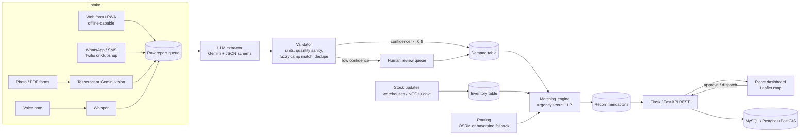
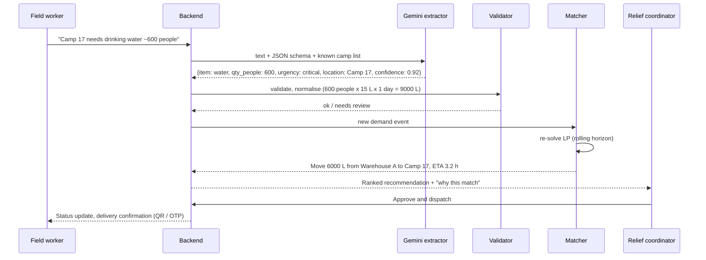
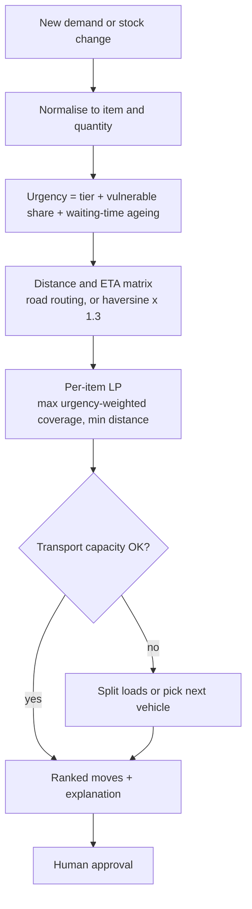
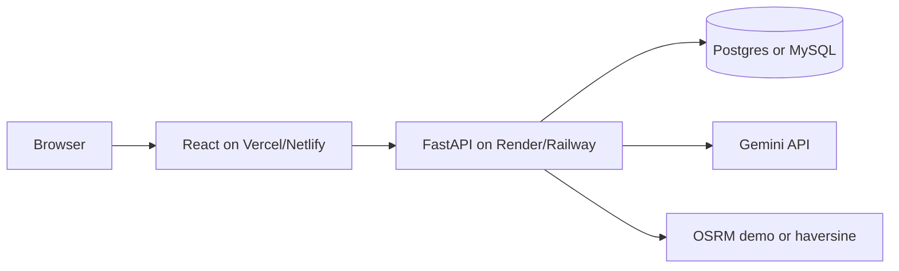

# ReliefOS: Architecture

Everything below builds on the stack in your deck (Tesseract + Gemini, Flask, MySQL, rule-based matching, OSM + Leaflet, React). Two changes are recommended: swap the rule-based score for a small LP (see `prototype/match.py`), and add a human review queue.

## 1. System architecture



## 2. End-to-end workflow (sequence)



## 3. Matching logic



Why LP instead of the plain score: a greedy "best match" double-allocates the same stock and can't split a warehouse across camps. The LP handles both and still runs in milliseconds at hackathon scale.

## 4. Data model

```mermaid
erDiagram
  LOCATION ||--o{ SUPPLY_LOT : holds
  LOCATION ||--o{ DEMAND : at
  LOCATION { int id string name string type float lat float lon }
  SUPPLY_LOT { int id int location_id string item int qty date expiry }
  DEMAND { int id int location_id string item int qty string tier float confidence string status int report_id }
  REPORT ||--o{ DEMAND : produces
  REPORT { int id text raw_text string channel string lang datetime received }
  VEHICLE { int id string type int capacity_kg int home_location_id }
  MOVE }o--|| SUPPLY_LOT : from
  MOVE }o--|| DEMAND : to
  MOVE { int id int qty float km float eta_h string status }
```

## 5. Deployment (hackathon)



## 6. Stack decisions

| Layer | Your deck | Recommendation |
|---|---|---|
| Backend | Flask | Fine. FastAPI is nicer for typed JSON schemas (Pydantic), but don't switch if the team knows Flask. |
| DB | MySQL | Fine for the hackathon. Postgres + PostGIS is better for geo queries later. |
| Matching | Rule-based | Keep the score for urgency, add the LP on top. |
| Extraction | Tesseract + Gemini | Use Gemini for both text and images. Keep Tesseract only as a fallback. |
| Routing | OSM + Leaflet | Leaflet for display. For distance use haversine x 1.3 and add OSRM only if time allows. |
| Offline | "Lightweight UI + sync" | Build a simple PWA form that queues to localStorage. Don't build real sync. |

Open items to check before the day: current Gemini model names and free-tier rate limits at ai.google.dev, and whether the OSRM public demo server is acceptable for your use (it has usage limits).
