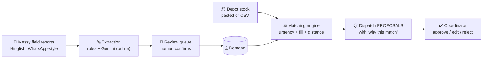
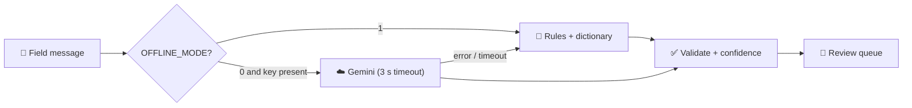

<div align="center">

# 🚑 ReliefOS

### WhatsApp chaos in, dispatch plan out.

**A coordinator-side decision engine for disaster relief. It turns messy field reports (English, Hindi, Hinglish) into structured demand, matches them to depot stock, and proposes dispatches that a human approves.**


-8e44ad)


[**💡 Idea**](#-the-idea) · [**✨ Features**](#-what-it-does) · [**🏗️ Architecture**](#️-architecture) · [**▶️ Run**](#️-run-it) · [**📋 Disclosure**](#-disclosure-what-was-built-before-vs-during) · [**📚 Docs**](#-documentation) · [**👭 Team**](#-team-koshish)

</div>

---

## 💡 The idea

After a disaster, supplies usually **exist**: in warehouses, NGO stores and government stockpiles. What fails is **matching supply to demand, in time, at scale.** Needs arrive as forwarded WhatsApp messages, calls and photos. Nobody has one picture of who needs what, where, and who has it.

ReliefOS keeps a live picture of **Supply → Demand → Distance → Urgency → Transport capacity** and proposes **what should move where**.

> **The AI proposes. The human decides.** Every move is approved, edited or rejected by a coordinator, with a plain-language explanation and an audit trail.



**Example.** This message:

> *"Camp 17 needs drinking water for approximately 600 people, urgent."*

becomes structured demand:

| Item | Quantity | Urgency | Location | Basis |
|---|---|---|---|---|
| Water | 600 people (≈ 9,000 L/day) | 🔴 Critical | Camp 17 | Sphere minimum: 15 L/person/day |

---

## 📊 Why it matters

| | |
|---|---|
| **~75%** | of relief spending went to supply-chain logistics (about 203M of 276M euros across 20 operations, 2023 study; older literature says 60-80%) |
| **14 → 27 Aug 2025** | gap between Punjab flooding starting and the first central situation report mentioning Punjab |
| **58%** | of surveyed people got no early warning in Pakistan's 2022 floods; 27 stakeholders and 39 ministries were involved |
| **Kerala 2018** | the state asked donors for money, not goods: unsolicited material was a "distraction" needing extra verification |

Sources and context: [`docs/01`](docs/01_problem_and_stats.md) · [`docs/02`](docs/02_case_studies.md). Only numbers tagged **[V]** in the docs go on slides.

---

## ✨ What it does

| | Feature | Detail |
|---|---|---|
| 🔤 | **Free-text intake** | Paste messy reports; no structured form on the coordinator page. Structure is the *output* |
| 🌍 | **Two doors** | Coordinator console (trusted) and a public report page (unverified until a human verifies it) |
| 👀 | **Review queue** | Low-confidence parses wait for a human. Corrections (item, quantity, urgency, location) are sent to the backend |
| 🧩 | **Duplicate clustering** | 30 reports from one area become **1 need** with `report_count = 30` (same camp + item, 6 h window, quantity ±20%) |
| 📦 | **Supply intake** | Depot stock pasted as text or uploaded as CSV, parsed by the same layer, stamped with `updated_at` |
| ⚖️ | **Explainable matching** | Greedy scoring (LP toggle). Each proposal carries a "why this match" sentence and score breakdown |
| ⚔️ | **Conflicts panel** | "Three camps, one truck": shows who got the scarce stock and why, derived from the real allocation |
| ⏰ | **Stale-stock warnings** | Flags depot stock older than a set number of hours before you rely on it |
| 📉 | **Shortage and surplus** | Unmet demand by item and district, with the nearest source; stock nobody needs |
| ✔️ | **Human approval** | Approve / edit / reject (reason required). Approved moves reserve stock and survive a re-run |
| 🧾 | **Audit log** | Every verify, correction and move decision is recorded and shown as Recent Activity |
| 📴 | **Offline queue** | Reports submitted with no connection are queued in the browser and sent in order, exactly once, when the server returns |
| 📱 | **Local-network join** | Phones join the laptop's hotspot via IP + QR code, no internet needed |

**Trust rules:** public input gets lower matching priority until verified · critical items are pinned to the top even if unverified · rate limit of 5 public reports per IP per minute · the same `client_uuid` sent twice creates one record · no OTP or accounts in this version.

---

## 🏗️ Architecture

### Two-door intake

```
Public page (no login)            Coordinator console (trusted)
  text + location + phone?          dashboard
  POST /api/public/report           POST /api/intake
  source="public"                   source="coordinator"
  verified=false                    verified=true
  needs_review=true (always)        needs_review = server flag
        └────────── same extraction chain ──────────┘
                          ↓
                same DB + matching engine
                          ↓
   Coordinator sees both: ✓ Verified (green) / ⚠ Unverified (amber)
   Verify / Reject tap on each unverified row
```

### Three run modes (same code, different switches)

| Mode | Where | Network | DB | AI | Distance |
|---|---|---|---|---|---|
| ☁️ **A. Cloud** | Render / Railway | Internet | MySQL or SQLite | Gemini first, rules fallback | OSRM if configured, else haversine |
| 📦 **B. Offline box** ("ReliefOS in a box") | One laptop on its own hotspot | **None** | SQLite | Rules + dictionary | Haversine × 1.3 |
| 📱 **C. Offline phone** | Phone browser | None | IndexedDB queue | None needed | n/a |

One environment variable switches the mode: `OFFLINE_MODE=1`. It removes Gemini and any public routing service at start-up, so nothing waits on a network timeout.

> **How we describe "offline":** *local-network offline.* The rules parser and the matching engine run with zero internet. AI parsing (Gemini) needs internet and is an **online bonus**. Banner text in the app: *"Works with zero internet on a local network. Internet adds AI parsing and chat-app intake."*

### Extraction provider chain



| Provider | Needs | Quality | Review rule |
|---|---|---|---|
| ☁️ Gemini | Internet + API key | Best, handles Hinglish | Server flags `needs_review` below the confidence threshold |
| 📏 Rules + dictionary | Nothing | Lowest, never fails | Confidence capped at **0.65**, so **every rules record goes to review** |

The UI shows which provider parsed each record. The frontend never calls Gemini; API keys live only in the backend `.env`. Cached Gemini answers are a demo safety net only, not an offline AI.

### How a recommendation is scored

```
score = feasible × ( 0.5 × urgency + 0.25 × fill + 0.25 × proximity )
```

- **urgency:** Critical 1.0, High 0.75, Medium 0.5, Low 0.25, plus a waiting-time bonus
- **fill:** how much of the need this stock can cover
- **proximity:** nearer is better. Distance is **haversine × 1.3** and always labelled as a straight-line estimate, never as a road distance
- **feasible:** vehicle available, within time limit

Weights are tunable by sliders in the UI. Every proposal stores its score breakdown, so it can be explained to a district officer. Details: [`docs/08`](docs/08_tech_stack_architecture.md#5-matching-engine).

### API (canonical contract)

```
GET  /api/health            GET  /api/join          GET  /api/locations     GET /api/items
GET  /api/demands           POST /api/intake        POST /api/public/report
POST /api/demands/<id>/correct | /verify | /reject
GET  /api/stock             POST /api/supply/paste  POST /api/supply/csv
POST /api/match/run         GET  /api/plan/latest   GET  /api/shortages
POST /api/moves/<id>/approve | /edit | /reject
GET  /api/audit
```

The frontend's typed client (`frontend/src/types.ts`) is the source of truth for response shapes. Urgency is lowercase in the API and uppercase inside the matcher; conversion happens only in the adapter layer (`backend/api_adapters.py`).

---

## 🛠️ Stack

| Layer | Tech |
|---|---|
| ⚙️ Backend | Python, Flask, SQLAlchemy |
| 🗄️ Database | SQLite (offline box, local dev) · MySQL (cloud) |
| 🔤 Extraction | Rules + dictionary (Hindi / Hinglish / Devanagari aliases) · Gemini (online only) |
| ⚖️ Matching | Rule-based scoring, greedy allocator, LP toggle |
| 🗺️ Routing | Haversine × 1.3 (OSRM optional, online) |
| 🖥️ Frontend | React, Vite, offline IndexedDB report queue, SVG map with a local GeoJSON basemap (Leaflet is a stretch goal) |
| 🚀 Deploy | Render (Railway as backup); `scripts/run_offline.sh` for the offline box |

---

## ▶️ Run it

```bash
# Backend
pip install -r backend/requirements.txt
OFFLINE_MODE=1 python -m pytest -q          # unit tests, no network
OFFLINE_MODE=1 bash scripts/run_offline.sh  # app + API on one port, prints URL + QR

# Frontend (dev with hot reload; proxies /api to localhost:5000)
cd frontend
npm install
PORT=5173 npm run dev
VITE_MOCK_MODE=1 PORT=5173 npm run dev      # frontend-only demo on mock data
npm run typecheck && npm run build          # produces frontend/dist, served by Flask

# Asset check (no CDN or public-tile URLs allowed in the build)
python scripts/check_assets.py
```

| Variable | Where | Meaning |
|---|---|---|
| `OFFLINE_MODE=1` | backend | No network calls; Gemini removed from the chain |
| `DATABASE_URL` | backend | Default `sqlite:///reliefos.db` |
| `GEMINI_API_KEY` | backend only | Enables Gemini when online. Never put it in the frontend |
| `STALE_HOURS` | backend | Age after which depot stock is flagged (default 6) |
| `RELIEFOS_HOST_IP` | backend | Force the IP shown in the QR join page |
| `VITE_API_URL` | frontend | Default `/api` |
| `VITE_MOCK_MODE=1` | frontend | Mock data, for backup demos only. Off by default: a dead backend shows an error, not fake data |

**Phones on the hotspot:** open the printed `http://<laptop-ip>:<port>` URL or scan the QR code. Plain `http://192.168.x.x` is not a secure context, so the browser's location button will not work there; users type their location instead. Do not rely on `reliefos.local`.

---

## 📋 Disclosure: what was built before vs. during

We want judges to see exactly what is new at this event and what is not.

### 🕰️ Before the hackathon (prep work, 25-29 Oct)
Our prep repo: `<link to original repo>`

The core rule engine was prebuilt. The frontend was not: only a basic mock-data prototype existed, and it is being rebuilt during the event, so none of the new frontend counts as prior work.

| Component | State at hackathon start |
|---|---|
| Matching engine (scoring, greedy allocator, LP toggle, shortage reports) | Written and unit-tested |
| Geo-routing (haversine × 1.3, offline-safe) | Written and unit-tested |
| Offline node (join endpoint, QR, basemap validator) | Written, not tested on a phone |
| Extraction (rules + Gemini fallback) | Written for 5 items |
| Old frontend | Basic mock-data prototype only, being replaced |
| Stub dictionaries, helper scripts | Placeholders |
| Research and architecture docs | Written |

35 unit tests existed and passed before the event.

### 🏁 During the hackathon (30-31 Oct)
- **Frontend rebuilt from scratch** (new coordinator console, public report page, offline queue, map) and wired to the real API
- Flask backend (`app.py`), API endpoints, seed data, `requirements.txt`
- Real item, unit and gazetteer dictionaries (Hindi/Hinglish)
- Extraction fixes, duplicate clustering, supply parsing
- Integration: extraction → matching → dashboard
- Human review queue
- Phone test over hotspot, with QR join
- Bug fixes, demo polish, slides, deployment

The import commit in this repo's history, `Import prep modules`, marks where prep work ends. Commits after it were made during the event.

---

## ⚠️ Honest limits

We would rather say these ourselves than have them found.

- **Synthetic data.** The demo runs on a synthetic Punjab-flood scenario. No real victim or NGO data is used.
- **Proposals, not dispatches.** The system never "assigns" or "dispatches". A human approves every move.
- **Straight-line distances.** Offline distances are haversine × 1.3 estimates, labelled as such, not road routing.
- **Offline means local network.** AI parsing and any chat-app intake need internet. The paste box is the intake channel for forwarded messages; there is no live WhatsApp or SMS integration yet.
- **Rules parser is a dictionary tool, not intelligence.** It handles a small set of items and phrases, so every rules record lands in review. Its accuracy is measured separately from Gemini's.
- **Matching trade-off (simulation, synthetic data).** ReliefOS beats a naive baseline on **critical-need coverage (100% vs 68.2%)** and critical ETA (about 29% faster). Overall coverage is slightly **lower** (70.5% vs 73.2%) and total distance is about 29% higher. It protects critical needs first; it does not maximise overall coverage.
- **Basemap.** The bundled district GeoJSON is a placeholder; its licence and provenance are still being checked.
- **No auth or OTP.** Public reports are protected by rate limiting, clustering and human verification, not by accounts.

---

## 📚 Documentation

| | Doc | What you get |
|---|---|---|
| 📈 | [01 Problem and stats](docs/01_problem_and_stats.md) | Verified numbers, Sphere standards, AI feasibility evidence |
| 🌊 | [02 Case studies](docs/02_case_studies.md) | Punjab 2025, Kerala 2018, Pakistan 2022, plus cases to research next |
| 🗃️ | [03 Datasets](docs/03_datasets.md) | HDX, OSM, CrisisNLP, and how to build our own gold set |
| 📖 | [04 Reading list](docs/04_reading_list.md) | Papers, handbooks and sites, prioritised |
| 🧭 | [05 Study roadmap](docs/05_study_roadmap.md) | Prep calendar and roles |
| 🎤 | [06 Pitch defense](docs/06_pitch_defense.md) | Likely judge questions and strong answers |
| 🥊 | [07 Competitive landscape](docs/07_competitive_landscape.md) | Sahana Eden, IDRN, Crisis Cleanup, Ushahidi and where we differ |
| 🧱 | [08 Tech stack and architecture](docs/08_tech_stack_architecture.md) | Stack, data model, AI pipeline, matching algorithm, API, screens |
| 🗺️ | [09 Architecture diagrams](docs/09_architecture_diagrams.md) | Mermaid diagrams: system, workflow, matching, data model |
| ⏱️ | [10 Hackathon plan](docs/10_hackathon_plan.md) | Hour-by-hour plan, demo script, judge Q&A |
| 📴 | [11 Offline infrastructure](docs/11_offline_infrastructure.md) | Offline phone, local node, sync roadmap |
| 🧪 | [`prototype/match.py`](prototype/match.py) | Original LP matching prototype on a Punjab sample |

> Some docs were written before the final scope was set. Where `docs/08` and `docs/10` differ from this README (for example endpoint names or the confidence threshold), **this README and the frontend's `types.ts` are current.**

---

## 🥊 How we differ from existing tools

Pieces of ReliefOS exist elsewhere: crisis mapping (Ushahidi), request tracking and inventory (Sahana Eden), resource registries (IDRN), claim-a-task boards (Crisis Cleanup). Our claim is narrower than "nobody does this":

> **Others map the crisis or register resources. ReliefOS reads the messy report, finds the stock, and proposes what to move where, with a visible reason.**

We do not replace the WhatsApp group. We **read it**, structure it, and give back a plan. Full comparison and honest caveats: [`docs/07`](docs/07_competitive_landscape.md).

---

## 🗂️ Repo layout

```
backend/
  extraction/       rules + Gemini providers, chain, dedupe, dictionaries (items, units, gazetteer)
  matching/         scoring, greedy, LP, shortages, simulate, explain
  offline/          QR join, basemap helpers
  routing.py        distance(a, b) -> {km, eta_h, source}
  api.py, api_adapters.py, models.py, app.py, config.py     Flask app and DB
  seed/             gazetteer, messages, supply, scenario data
  tests/            pytest suite (no_network fixture)
frontend/           React + Vite app, public report page, IndexedDB queue
scripts/            run_offline.sh, check_assets.py, build_offline_pack.sh, smoke_api.py
docs/               research, architecture, offline design, pitch
prototype/          original LP prototype and the old frontend (kept for reference)
```

---

## 🗓️ Status

| Area | Status |
|---|---|
| Matching engine, routing, offline node, rules + Gemini extraction | ✅ Built before the event, 35 tests passing |
| Frontend rebuild | 🔄 In progress during the event |
| Flask API, DB, seed scenario | 🔄 In progress during the event |
| Public report page, duplicate clustering, supply intake | 🔄 In progress during the event |
| Phone test over hotspot | ⬜ Scheduled for the event |
| Deployment (Render) and backup demo video | ⬜ Scheduled for the event |

**Key dates:** hackathon 30-31 Oct 2026, Chandigarh University, Mohali. Feature freeze at hour 22.

---

## 👭 Team Koshish

| | Role |
|---|---|
| **Ridhima Gogia** (lead) | Matching engine, explanations, seed scenario, phone test, final demo |
| **Khushali Kakkar** | Flask API, database, audit log, deployment |
| **Navya Gupta** | Extraction, dictionaries, duplicate clustering, seed messages |
| **Aastha Jha** | Frontend, public report page, slides |

Vivekanand Institute of Professional Studies (VIPS-TC), Delhi · GGSIPU

---

## 🔎 How to read the research docs

| Tag | Meaning |
|---|---|
| **[V]** | Verified against a linked source during research |
| **[B]** | Background knowledge, not yet re-verified. Check before it goes on a slide |

Do not put a statistic on a slide unless it is tagged **[V]** and you have opened the source.

<div align="center">

*Built for people who need help to reach the right place at the right time.*

</div>
