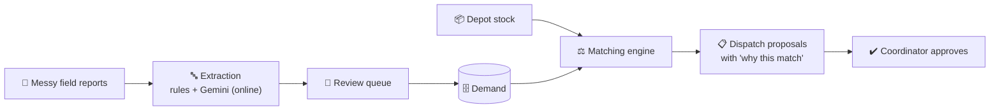

<div align="center">

# 🚑 ReliefOS

### WhatsApp chaos in, dispatch plan out.

**A coordinator-side decision engine for disaster relief. It turns messy field reports (English, Hindi, Hinglish) into structured demand, matches them to depot stock, and proposes dispatches that a human approves.**


[**💡 Idea**](#-the-idea) · [**✨ Features**](#-features) · [**🏗️ How it works**](#️-how-it-works) · [**▶️ Run**](#️-run-it) · [**📚 Docs**](#-research-docs) · [**👭 Team**](#-team-koshish)

</div>

---

## 💡 The idea

After a disaster, supplies usually **exist** in warehouses, NGO stores and government stockpiles. What fails is **matching supply to demand, in time**. Needs arrive as forwarded WhatsApp messages, calls and photos, and nobody has one picture of who needs what, where, and who has it.

ReliefOS turns that chaos into a ranked plan. **The AI proposes. The human decides.** Every move is approved, edited or rejected by a coordinator, with a plain-language explanation and an audit trail.



> *"Camp 17 needs drinking water for approximately 600 people, urgent."*
> becomes **Water · 600 people (≈ 9,000 L/day, Sphere minimum 15 L/person/day) · 🔴 Critical · Camp 17**

**Why it matters:** about 75% of relief spending goes to supply-chain logistics (2023 study across 20 operations). In Punjab 2025, the first central situation report mentioning Punjab came 13 days after flooding began. Sources: [`docs/01`](docs/01_problem_and_stats.md), [`docs/02`](docs/02_case_studies.md).

---

## ✨ Features

- 🔤 **Free-text intake:** paste messy reports; no structured form on the coordinator page
- 🌍 **Two doors:** coordinator console (trusted) and a public report page (unverified until a human verifies it)
- 👀 **Review queue:** low-confidence parses wait for a human, and corrections are saved
- 🧩 **Duplicate clustering:** 30 reports from one area become 1 need with `report_count = 30`
- 📦 **Supply intake:** depot stock pasted or uploaded as CSV, with `updated_at` and stale-stock warnings
- ⚖️ **Explainable matching:** greedy scoring (LP toggle), a "why this match" sentence per move, weight sliders
- ⚔️ **Conflicts panel:** "three camps, one truck" shows who got scarce stock and why
- ✔️ **Human approval:** approve / edit / reject (reason required), with an audit log
- 📴 **Offline queue:** reports made without a connection are sent in order, exactly once, when the server returns
- 📱 **Local-network join:** phones join the laptop's hotspot via IP + QR code

**Trust rules:** public input has lower priority until verified · critical items are pinned to the top even if unverified · 5 public reports per IP per minute · the same `client_uuid` twice creates one record · no OTP or accounts.

---

## 🏗️ How it works

**Two-door intake**

```
Public page (no login)            Coordinator console (trusted)
  POST /api/public/report           POST /api/intake
  source=public, verified=false     source=coordinator, verified=true
  needs_review=true (always)        needs_review = server flag
        └────────── same extraction chain ──────────┘
                          ↓
                same DB + matching engine
                          ↓
   Coordinator sees ✓ Verified / ⚠ Unverified, with Verify / Reject on each unverified row
```

**Offline, honestly.** ReliefOS is *local-network offline*: the rules parser and the matching engine run with zero internet (`OFFLINE_MODE=1`). Gemini parsing needs internet and is an online bonus. Rules records are capped at confidence 0.65, so every offline record goes to the review queue.

**Scoring**

```
score = feasible × ( 0.5 × urgency + 0.25 × fill + 0.25 × proximity )
```

Urgency (Critical 1.0 → Low 0.25, plus waiting time), fill (share of the need covered) and proximity (nearer is better). Distance is **haversine × 1.3**, always labelled as a straight-line estimate. Each proposal stores its score breakdown.

**Stack:** Python, Flask, SQLAlchemy · SQLite (offline box) / MySQL (cloud) · rules + dictionary extraction, Gemini online only · React, Vite, IndexedDB queue, SVG map with a local GeoJSON basemap · Render for deployment.

---

## ▶️ Run it

```bash
# Backend
pip install -r backend/requirements.txt
OFFLINE_MODE=1 python -m pytest -q
OFFLINE_MODE=1 bash scripts/run_offline.sh      # app + API on one port, prints URL + QR

# Frontend
cd frontend && npm install
PORT=5173 npm run dev                           # proxies /api to localhost:5000
npm run typecheck && npm run build              # frontend/dist, served by Flask
```

| Variable | Meaning |
|---|---|
| `OFFLINE_MODE=1` | No network calls; Gemini removed from the chain |
| `GEMINI_API_KEY` | Backend only. Enables Gemini when online |
| `DATABASE_URL` | Default `sqlite:///reliefos.db` |
| `STALE_HOURS` | Stock older than this is flagged (default 6) |
| `VITE_MOCK_MODE=1` | Frontend mock data, for backup demos only |

Phones on the hotspot open the printed `http://<laptop-ip>:<port>` URL or scan the QR code. Over plain HTTP the browser blocks the location button, so users type their location instead.

---

## ⚠️ Limits

- The demo uses a **synthetic** Punjab-flood scenario, not real data.
- Moves are **proposals**; a human approves every one.
- Offline distances are straight-line estimates, not road routing.
- No live WhatsApp or SMS integration yet; the paste box is the intake channel.
- In simulation, ReliefOS protects **critical needs first** (100% vs 68.2% critical coverage against a naive baseline), but overall coverage is slightly lower (70.5% vs 73.2%) and total distance is higher.
- The bundled district basemap is a placeholder.

---

## 📚 Research docs

| | Doc | What you get |
|---|---|---|
| 📈 | [01 Problem and stats](docs/01_problem_and_stats.md) | Verified numbers, Sphere standards, AI feasibility evidence |
| 🌊 | [02 Case studies](docs/02_case_studies.md) | Punjab 2025, Kerala 2018, Pakistan 2022 |
| 🗃️ | [03 Datasets](docs/03_datasets.md) | HDX, OSM, CrisisNLP, and how to build a gold set |
| 📖 | [04 Reading list](docs/04_reading_list.md) | Papers, handbooks and sites, prioritised |
| 🧭 | [05 Study roadmap](docs/05_study_roadmap.md) | Prep calendar and roles |
| 🎤 | [06 Pitch defense](docs/06_pitch_defense.md) | Likely judge questions and answers |
| 🥊 | [07 Competitive landscape](docs/07_competitive_landscape.md) | Sahana Eden, IDRN, Crisis Cleanup, Ushahidi and where we differ |

Tags in these docs: **[V]** verified against a linked source, **[B]** background knowledge to re-check before it goes on a slide.

---

## 👭 Team Koshish

**Ridhima Gogia** (lead) · **Khushali Kakkar** · **Navya Gupta** · **Aastha Jha**
Vivekanand Institute of Professional Studies (VIPS-TC), Delhi · GGSIPU

<div align="center">

*Built for people who need help to reach the right place at the right time.*

</div>
