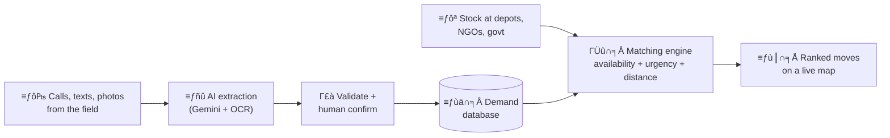

<div align="center">

# 🚨 ReliefOS

### Right help. Right place. Right time.

**Disaster-relief supply matching: messy field reports in, ranked relief moves out.**


[**📚 Research**](#-research-pack) · [**🏗️ Architecture**](#️-architecture--build) · [**🧪 Prototype**](#-try-the-prototype) · [**🗓️ Plan**](#️-plan--status) · [**🎤 Pitch**](#-pitch-kit)

</div>

---

## 💡 The idea in 30 seconds

After a disaster, supplies usually **exist**: in warehouses, NGO stores and government stockpiles. What fails is **matching supply to demand, in time, at scale.**

ReliefOS keeps a live picture of **Supply → Demand → Distance → Urgency → Transport capacity** and tells relief organisations **what should move where**.



**Example.** The AI layer turns this:

> *"Camp 17 needs drinking water for approximately 600 people."*

into structured demand:

| Item | Quantity | Urgency | Location | Basis |
|---|---|---|---|---|
| Water | 600 people (≈ 9,000 L/day) | 🔴 Critical | Camp 17 | Sphere minimum: 15 L/person/day |

---

## 📊 Why it matters (verified numbers)

| | |
|---|---|
| **~75%** | of relief spending goes to supply-chain logistics (203M of 276M euros across 20 operations, 2023 study; older literature says 60-80%) |
| **14 → 27 Aug 2025** | gap between Punjab floods starting and the first central situation report mentioning Punjab |
| **58%** | of surveyed people got no early warning in Pakistan's 2022 floods; 27 stakeholders and 39 ministries involved |
| **Kerala 2018** | state asked donors to send money, not goods: unsolicited material was a "distraction" needing extra verification |

➡️ Sources and full context: [`docs/01_problem_and_stats.md`](docs/01_problem_and_stats.md)

---

## 📚 Research pack

| | Doc | What you get |
|---|---|---|
| 📈 | [01 Problem and stats](docs/01_problem_and_stats.md) | Verified numbers, Sphere standards, AI feasibility evidence |
| 🌊 | [02 Case studies](docs/02_case_studies.md) | Punjab 2025, Kerala 2018, Pakistan 2022, plus 7 cases to research next |
| 🗃️ | [03 Datasets](docs/03_datasets.md) | HDX, OSM, CrisisNLP and friends, plus how to build your own gold set |
| 📖 | [04 Reading list](docs/04_reading_list.md) | Papers, handbooks and sites, prioritised P1/P2/P3 |
| 🧭 | [05 Study roadmap](docs/05_study_roadmap.md) | Day-by-day plan to 30 Oct and who owns what |
| 🎤 | [06 Pitch defense](docs/06_pitch_defense.md) | Likely judge questions and strong answers |
| 🥊 | [07 Competitive landscape](docs/07_competitive_landscape.md) | Ushahidi, Sahana, IDRN and where we differ (to verify) |

## 🏗️ Architecture and build

| | Doc | What you get |
|---|---|---|
| 🧱 | [08 Tech stack and architecture](docs/08_tech_stack_architecture.md) | Stack, data model, AI pipeline, matching algorithm, API, screens, offline plan |
| 🗺️ | [09 Architecture diagrams](docs/09_architecture_diagrams.md) | Mermaid diagrams: system, workflow, matching, data model |
| ⏱️ | [10 Hackathon plan](docs/10_hackathon_plan.md) | Prebuild list, hour-by-hour plan, must/don't, demo script, judge Q&A |
| 📴 | [11 Offline infrastructure](docs/11_offline_infrastructure.md) | Works with no network: offline PWA, local "ReliefOS in a box" node, sync and radio roadmap |
| 🧪 | [`prototype/match.py`](prototype/match.py) | Working LP matching engine on a Punjab sample |

### Pitched stack

| Layer | Tech |
|---|---|
| 🤖 AI and OCR | Gemini API, Tesseract |
| ⚙️ Backend | Python, Flask, SQLAlchemy |
| 🗄️ Database | MySQL (SQLite for local dev) |
| ⚖️ Matching | Rule-based scoring, greedy, LP/OR-Tools upgrade |
| 🗺️ Maps and routing | OpenStreetMap, Leaflet, OSRM |
| 🖥️ Frontend | React, Vite, Tailwind, offline PWA queue |

<details>
<summary><b>How a recommendation is scored</b> (click to expand)</summary>

```
score = feasible × ( 0.5 × urgency + 0.25 × fill + 0.25 × proximity )
```

- **urgency**: Critical 1.0, High 0.75, Medium 0.5, Low 0.25, plus a waiting-time bonus
- **fill**: how much of the need this stock can cover
- **proximity**: nearer is better
- **feasible**: vehicle available, within time limit, road accessible

Weights are tunable by sliders in the UI, and every recommendation stores its score breakdown, so it is explainable to a district officer.
Full detail: [`docs/08`](docs/08_tech_stack_architecture.md#5-matching-engine)

</details>

---

## 🧪 Try the prototype

```bash
pip install scipy numpy
python prototype/match.py
```

Sample output (Punjab scenario):

```
blanket  A-Ludhiana-WH  →  B-Ferozepur   7000   153.8 km   ETA 4.9 h
water_l  A-Ludhiana-WH  →  Camp17        6000    59.8 km   ETA 2.2 h
ors      C-Patiala-NGO  →  B-Ferozepur   2500   237.2 km   ETA 7.3 h
```

---

## 🗓️ Plan and status

| Step | Deliverable | Status |
|---|---|---|
| 1 | Research pack (`docs/01`-`07`) | ✅ Done |
| 2 | Tech stack and architecture (`docs/08`) | ✅ Done |
| 3 | Diagrams (`docs/09`) | ✅ Merged, review and extend |
| 4 | Hackathon plan and LP prototype (`docs/10`, `prototype/`) | ✅ Merged, align with `docs/08` |
| 5 | Gold test set: 150 English/Hindi/Hinglish field messages | Γ¼£ To do |
| 6 | Synthetic Punjab-flood scenario data | Γ¼£ To do |
| 7 | Pitch dry-runs and backup demo video | Γ¼£ To do |

**Key dates:** build and rehearse 18-28 Oct ┬╖ feature freeze 29 Oct ┬╖ hackathon 30-31 Oct, Chandigarh University, Mohali.

### ✅ Before the hackathon checklist

- [ ] Freeze: Flask vs FastAPI, MySQL vs SQLite, one primary demo scenario (Punjab flood)
- [ ] Decide the main matcher: greedy (explainable) vs LP (optimal), with the other as fallback
- [ ] Gemini API key and quota checked, cached responses for scripted demo inputs
- [ ] Gold set of 150 messages built and accuracy measured
- [ ] Demo runs offline except the LLM call
- [ ] Hackathon rules checked on pre-written code
- [ ] Verify every number on the slides against the sources

---

## 🎤 Pitch kit

- **Problem framing:** supplies exist, matching fails. See [`docs/01`](docs/01_problem_and_stats.md).
- **Real story:** Punjab 2025 parallel, uncoordinated relief. See [`docs/02`](docs/02_case_studies.md).
- **Judge Q&A:** [`docs/06`](docs/06_pitch_defense.md) and [`docs/10`](docs/10_hackathon_plan.md).
- **Business model:** NGO SaaS ┬╖ CSR management platform ┬╖ government contracts ┬╖ relief-logistics partnerships.

---

## 👥 Team Koshish

Ridhima Gogia ┬╖ Khushali Kakkar ┬╖ Navya Gupta ┬╖ Aastha Jha
Vivekanand Institute of Professional Studies (VIPS-TC), Delhi ┬╖ GGSIPU

---

## 🔎 How to read this repo

| Tag | Meaning |
|---|---|
| **[V]** | Verified against a linked source during research |
| **[B]** | Background knowledge, not yet re-verified. Check before it goes on a slide |

Do not put a statistic on a slide unless it is tagged **[V]** and you have opened the source.

<div align="center">

*Built for people who need help to reach the right place at the right time.*

</div>
