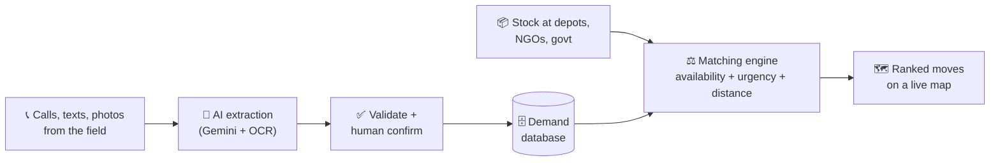
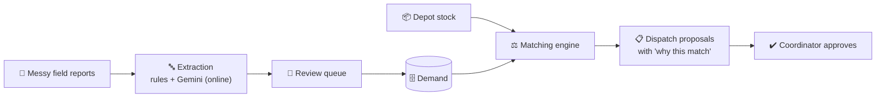

<div align="center">

<<<<<<< HEAD
# 🚨 ReliefOS

### Right help. Right place. Right time.

**Disaster-relief supply matching: messy field reports in, ranked relief moves out.**


[**📚 Research**](#-research-pack) · [**🏗️ Architecture**](#️-architecture--build) · [**🧪 Prototype**](#-try-the-prototype) · [**🗓️ Plan**](#️-plan--status) · [**🎤 Pitch**](#-pitch-kit)
=======
# 🚑 ReliefOS

### WhatsApp chaos in, dispatch plan out.

**A coordinator-side decision engine for disaster relief. It turns messy field reports (English, Hindi, Hinglish) into structured demand, matches them to depot stock, and proposes dispatches that a human approves.**


[**💡 Idea**](#-the-idea) · [**✨ Features**](#-features) · [**🏗️ How it works**](#️-how-it-works) · [**▶️ Run**](#️-run-it) · [**📚 Docs**](#-research-docs) · [**👭 Team**](#-team-koshish)
>>>>>>> a0f494179b6b8530287d27c2c97a2c6c4f581382

</div>

---

<<<<<<< HEAD
## 💡 The idea in 30 seconds

After a disaster, supplies usually **exist**: in warehouses, NGO stores and government stockpiles. What fails is **matching supply to demand, in time, at scale.**

ReliefOS keeps a live picture of **Supply → Demand → Distance → Urgency → Transport capacity** and tells relief organisations **what should move where**.



**Example.** The AI layer turns this:

> *"Camp 17 needs drinking water for approximately 600 people."*

into structured demand:

| Item | Quantity | Urgency | Location | Basis |
|---|---|---|---|---|
| Water | 600 people (≈ 9,000 L/day) | 🔴 Critical | Camp 17 | Sphere minimum: 15 L/person/day |

---

## 📊 Why it matters (verified numbers)

| | |
|---|---|
| **~75%** | of relief spending goes to supply-chain logistics (203M of 276M euros across 20 operations, 2023 study; older literature says 60-80%) |
| **14 → 27 Aug 2025** | gap between Punjab floods starting and the first central situation report mentioning Punjab |
| **58%** | of surveyed people got no early warning in Pakistan's 2022 floods; 27 stakeholders and 39 ministries involved |
| **Kerala 2018** | state asked donors to send money, not goods: unsolicited material was a "distraction" needing extra verification |

➡️ Sources and full context: [`docs/01_problem_and_stats.md`](docs/01_problem_and_stats.md)

---

## 📚 Research pack

| | Doc | What you get |
|---|---|---|
| 📈 | [01 Problem and stats](docs/01_problem_and_stats.md) | Verified numbers, Sphere standards, AI feasibility evidence |
| 🌊 | [02 Case studies](docs/02_case_studies.md) | Punjab 2025, Kerala 2018, Pakistan 2022, plus 7 cases to research next |
| 🗃️ | [03 Datasets](docs/03_datasets.md) | HDX, OSM, CrisisNLP and friends, plus how to build your own gold set |
| 📖 | [04 Reading list](docs/04_reading_list.md) | Papers, handbooks and sites, prioritised P1/P2/P3 |
| 🧭 | [05 Study roadmap](docs/05_study_roadmap.md) | Day-by-day plan to 30 Oct and who owns what |
| 🎤 | [06 Pitch defense](docs/06_pitch_defense.md) | Likely judge questions and strong answers |
| 🥊 | [07 Competitive landscape](docs/07_competitive_landscape.md) | Ushahidi, Sahana, IDRN and where we differ (to verify) |

## 🏗️ Architecture and build

| | Doc | What you get |
|---|---|---|
| 🧱 | [08 Tech stack and architecture](docs/08_tech_stack_architecture.md) | Stack, data model, AI pipeline, matching algorithm, API, screens, offline plan |
| 🗺️ | [09 Architecture diagrams](docs/09_architecture_diagrams.md) | Mermaid diagrams: system, workflow, matching, data model |
| ⏱️ | [10 Hackathon plan](docs/10_hackathon_plan.md) | Prebuild list, hour-by-hour plan, must/don't, demo script, judge Q&A |
| 📴 | [11 Offline infrastructure](docs/11_offline_infrastructure.md) | Works with no network: offline PWA, local "ReliefOS in a box" node, sync and radio roadmap |
| 🧪 | [`prototype/match.py`](prototype/match.py) | Working LP matching engine on a Punjab sample |

### Pitched stack

| Layer | Tech |
|---|---|
| 🤖 AI and OCR | Gemini API, Tesseract |
| ⚙️ Backend | Python, Flask, SQLAlchemy |
| 🗄️ Database | MySQL (SQLite for local dev) |
| ⚖️ Matching | Rule-based scoring, greedy, LP/OR-Tools upgrade |
| 🗺️ Maps and routing | OpenStreetMap, Leaflet, OSRM |
| 🖥️ Frontend | React, Vite, Tailwind, offline PWA queue |

<details>
<summary><b>How a recommendation is scored</b> (click to expand)</summary>
=======
## 💡 The idea

After a disaster, supplies usually **exist** in warehouses, NGO stores and government stockpiles. What fails is **matching supply to demand, in time**. Needs arrive as forwarded WhatsApp messages, calls and photos, and nobody has one picture of who needs what, where, and who has it.

ReliefOS turns that chaos into a ranked plan. **The AI proposes. The human decides.** Every move is approved, edited or rejected by a coordinator, with a plain-language explanation and an audit trail.



> *"Camp 17 needs drinking water for approximately 600 people, urgent."*
> becomes **Water · 600 people (≈ 9,000 L/day, Sphere minimum 15 L/person/day) · 🔴 Critical · Camp 17**

**Why it matters:** about 75% of relief spending goes to supply-chain logistics (2023 study across 20 operations). In Punjab 2025, the first central situation report mentioning Punjab came 13 days after flooding began. Sources: [`docs/01`](docs/01_problem_and_stats.md), [`docs/02`](docs/02_case_studies.md).

---

## ✨ Features

- 🔤 **Free-text intake:** paste messy reports; no structured form on the coordinator page
- 🌍 **Two doors:** coordinator console (trusted) and a public report page (unverified until a human verifies it)
- 👀 **Review queue:** low-confidence parses wait for a human, and corrections are saved
- 🧩 **Duplicate clustering:** 30 reports from one area become 1 need with `report_count = 30`
- 📦 **Supply intake:** depot stock pasted or uploaded as CSV, with `updated_at` and stale-stock warnings
- ⚖️ **Explainable matching:** greedy scoring (LP toggle), a "why this match" sentence per move, weight sliders
- ⚔️ **Conflicts panel:** "three camps, one truck" shows who got scarce stock and why
- ✔️ **Human approval:** approve / edit / reject (reason required), with an audit log
- 📴 **Offline queue:** reports made without a connection are sent in order, exactly once, when the server returns
- 📱 **Local-network join:** phones join the laptop's hotspot via IP + QR code

**Trust rules:** public input has lower priority until verified · critical items are pinned to the top even if unverified · 5 public reports per IP per minute · the same `client_uuid` twice creates one record · no OTP or accounts.

---

## 🏗️ How it works

**Two-door intake**

```
Public page (no login)            Coordinator console (trusted)
  POST /api/public/report           POST /api/intake
  source=public, verified=false     source=coordinator, verified=true
  needs_review=true (always)        needs_review = server flag
        └────────── same extraction chain ──────────┘
                          ↓
                same DB + matching engine
                          ↓
   Coordinator sees ✓ Verified / ⚠ Unverified, with Verify / Reject on each unverified row
```

**Offline, honestly.** ReliefOS is *local-network offline*: the rules parser and the matching engine run with zero internet (`OFFLINE_MODE=1`). Gemini parsing needs internet and is an online bonus. Rules records are capped at confidence 0.65, so every offline record goes to the review queue.

**Scoring**
>>>>>>> a0f494179b6b8530287d27c2c97a2c6c4f581382

```
score = feasible × ( 0.5 × urgency + 0.25 × fill + 0.25 × proximity )
```

<<<<<<< HEAD
- **urgency**: Critical 1.0, High 0.75, Medium 0.5, Low 0.25, plus a waiting-time bonus
- **fill**: how much of the need this stock can cover
- **proximity**: nearer is better
- **feasible**: vehicle available, within time limit, road accessible

Weights are tunable by sliders in the UI, and every recommendation stores its score breakdown, so it is explainable to a district officer.
Full detail: [`docs/08`](docs/08_tech_stack_architecture.md#5-matching-engine)

</details>

---

## 🧪 Try the prototype

```bash
pip install scipy numpy
python prototype/match.py
```

Sample output (Punjab scenario):

```
blanket  A-Ludhiana-WH  →  B-Ferozepur   7000   153.8 km   ETA 4.9 h
water_l  A-Ludhiana-WH  →  Camp17        6000    59.8 km   ETA 2.2 h
ors      C-Patiala-NGO  →  B-Ferozepur   2500   237.2 km   ETA 7.3 h
```

---

## 🗓️ Plan and status

| Step | Deliverable | Status |
|---|---|---|
| 1 | Research pack (`docs/01`-`07`) | ✅ Done |
| 2 | Tech stack and architecture (`docs/08`) | ✅ Done |
| 3 | Diagrams (`docs/09`) | ✅ Merged, review and extend |
| 4 | Hackathon plan and LP prototype (`docs/10`, `prototype/`) | ✅ Merged, align with `docs/08` |
| 5 | Gold test set: 150 English/Hindi/Hinglish field messages | ⬜ To do |
| 6 | Synthetic Punjab-flood scenario data | ⬜ To do |
| 7 | Pitch dry-runs and backup demo video | ⬜ To do |

**Key dates:** build and rehearse 18-28 Oct · feature freeze 29 Oct · hackathon 30-31 Oct, Chandigarh University, Mohali.

### ✅ Before the hackathon checklist

- [ ] Freeze: Flask vs FastAPI, MySQL vs SQLite, one primary demo scenario (Punjab flood)
- [ ] Decide the main matcher: greedy (explainable) vs LP (optimal), with the other as fallback
- [ ] Gemini API key and quota checked, cached responses for scripted demo inputs
- [ ] Gold set of 150 messages built and accuracy measured
- [ ] Demo runs offline except the LLM call
- [ ] Hackathon rules checked on pre-written code
- [ ] Verify every number on the slides against the sources

---

## 🎤 Pitch kit

- **Problem framing:** supplies exist, matching fails. See [`docs/01`](docs/01_problem_and_stats.md).
- **Real story:** Punjab 2025 parallel, uncoordinated relief. See [`docs/02`](docs/02_case_studies.md).
- **Judge Q&A:** [`docs/06`](docs/06_pitch_defense.md) and [`docs/10`](docs/10_hackathon_plan.md).
- **Business model:** NGO SaaS · CSR management platform · government contracts · relief-logistics partnerships.

---

## 👥 Team Koshish

Ridhima Gogia · Khushali Kakkar · Navya Gupta · Aastha Jha
Vivekanand Institute of Professional Studies (VIPS-TC), Delhi · GGSIPU

---

## 🔎 How to read this repo

| Tag | Meaning |
|---|---|
| **[V]** | Verified against a linked source during research |
| **[B]** | Background knowledge, not yet re-verified. Check before it goes on a slide |

Do not put a statistic on a slide unless it is tagged **[V]** and you have opened the source.
=======
Urgency (Critical 1.0 → Low 0.25, plus waiting time), fill (share of the need covered) and proximity (nearer is better). Distance is **haversine × 1.3**, always labelled as a straight-line estimate. Each proposal stores its score breakdown.

**Stack:** Python, Flask, SQLAlchemy · SQLite (offline box) / MySQL (cloud) · rules + dictionary extraction, Gemini online only · React, Vite, IndexedDB queue, SVG map with a local GeoJSON basemap · Render for deployment.

---

## ▶️ Run it

```bash
# Backend
pip install -r backend/requirements.txt
OFFLINE_MODE=1 python -m pytest -q
OFFLINE_MODE=1 bash scripts/run_offline.sh      # app + API on one port, prints URL + QR

# Frontend
cd frontend && npm install
PORT=5173 npm run dev                           # proxies /api to localhost:5000
npm run typecheck && npm run build              # frontend/dist, served by Flask
```

| Variable | Meaning |
|---|---|
| `OFFLINE_MODE=1` | No network calls; Gemini removed from the chain |
| `GEMINI_API_KEY` | Backend only. Enables Gemini when online |
| `DATABASE_URL` | Default `sqlite:///reliefos.db` |
| `STALE_HOURS` | Stock older than this is flagged (default 6) |
| `VITE_MOCK_MODE=1` | Frontend mock data, for backup demos only |

Phones on the hotspot open the printed `http://<laptop-ip>:<port>` URL or scan the QR code. Over plain HTTP the browser blocks the location button, so users type their location instead.

---

## ⚠️ Limits

- The demo uses a **synthetic** Punjab-flood scenario, not real data.
- Moves are **proposals**; a human approves every one.
- Offline distances are straight-line estimates, not road routing.
- No live WhatsApp or SMS integration yet; the paste box is the intake channel.
- In simulation, ReliefOS protects **critical needs first** (100% vs 68.2% critical coverage against a naive baseline), but overall coverage is slightly lower (70.5% vs 73.2%) and total distance is higher.
- The bundled district basemap is a placeholder.

---

## 📚 Research docs

| | Doc | What you get |
|---|---|---|
| 📈 | [01 Problem and stats](docs/01_problem_and_stats.md) | Verified numbers, Sphere standards, AI feasibility evidence |
| 🌊 | [02 Case studies](docs/02_case_studies.md) | Punjab 2025, Kerala 2018, Pakistan 2022 |
| 🗃️ | [03 Datasets](docs/03_datasets.md) | HDX, OSM, CrisisNLP, and how to build a gold set |
| 📖 | [04 Reading list](docs/04_reading_list.md) | Papers, handbooks and sites, prioritised |
| 🧭 | [05 Study roadmap](docs/05_study_roadmap.md) | Prep calendar and roles |
| 🎤 | [06 Pitch defense](docs/06_pitch_defense.md) | Likely judge questions and answers |
| 🥊 | [07 Competitive landscape](docs/07_competitive_landscape.md) | Sahana Eden, IDRN, Crisis Cleanup, Ushahidi and where we differ |

Tags in these docs: **[V]** verified against a linked source, **[B]** background knowledge to re-check before it goes on a slide.

---

## 👭 Team Koshish

**Ridhima Gogia** (lead) · **Khushali Kakkar** · **Navya Gupta** · **Aastha Jha**
Vivekanand Institute of Professional Studies (VIPS-TC), Delhi · GGSIPU
>>>>>>> a0f494179b6b8530287d27c2c97a2c6c4f581382

<div align="center">

*Built for people who need help to reach the right place at the right time.*

</div>
