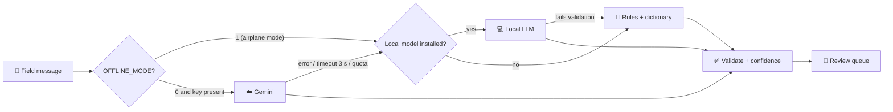

# 08. Tech Stack and Architecture (v2: online + offline)

[⬅ README](../README.md) · [Hackathon plan](10_hackathon_plan.md) · [Offline design](11_offline_infrastructure.md)

Aligned with the pitched stack (Tesseract + Gemini, Flask, MySQL, rule-based engine, OSM + Leaflet, React). Upgrades are marked **[optional]**. Items from background knowledge that need checking are marked **[B]**.

> **What changed in v2:** the system now runs in three modes (cloud, offline box, offline phone). Every online service has an offline replacement behind one switch, `OFFLINE_MODE`. The decisions below match [docs/10](10_hackathon_plan.md): same contract names (`DemandDraft`, `distance()`, `/api/health`), same owners (person numbers 1-4).

## 1. System in one view


*Full-resolution diagram: [images/architecture.jpg](images/architecture.jpg). ⚠️ This image was drawn before the offline work and does not show the provider chain or the offline box. Treat the text diagram below as the current one until the image is redrawn.*

```
 FIELD INPUT                  INTAKE + AI                          CORE                         OUTPUT
 -----------                  -----------                          ----                         ------
 Web form (PWA, queues  ----> Ingest API  ---> Extraction provider chain ---> Validation  --->  SQLite (box)
   offline, client UUID)      (idempotent       Gemini -> Local LLM -> Rules   + human confirm    or MySQL (cloud)
 Pasted text / chat ------->   on UUID)         (Tesseract for printed photos)                    (demands, stock,
 Photo of list / note ----->                                                                       depots, vehicles)
 Stock sheets (CSV) -------> Import API ---------------------------------------------------->          |
                                                                                                       v
                          Matching engine (score + greedy) <--- distance(): OSRM, else haversine x 1.3
                                          |
                                          v
                   Recommendations (moves) --> React dashboard + Leaflet map (GeoJSON basemap, tiles optional)
                                          |
                                          v
                        Dispatch log / audit trail / op-log / CSV export
```

### Three run modes (same code, different switches)

| Mode | Where | Network | DB | AI | Distance | Map |
|---|---|---|---|---|---|---|
| ☁️ **A. Cloud / online** | Render/Railway or Docker Compose | Internet | MySQL | Gemini first, then fallbacks | OSRM, else haversine | OSM tiles or GeoJSON |
| 📦 **B. Offline box** ("ReliefOS in a box") | One laptop on its own hotspot | **None** | SQLite | Local LLM (if installed) or rules | Haversine × 1.3 (local OSRM optional) | Bundled GeoJSON (local tiles optional) |
| 📱 **C. Offline phone** | Field phone browser | None to the box or the internet | IndexedDB queue | Rules on the form, no AI needed | n/a | Cached basemap |

Mode is set by environment variable, not by editing code: `OFFLINE_MODE=1 ./scripts/run_offline.sh`.

## 2. Components and technology choices

Owner numbers: **1** Frontend · **2** Backend/DB · **3** AI · **4** Matching, geo and offline node.

| Layer | Online choice | Offline choice | Why | Fallback | Owner |
|---|---|---|---|---|---|
| Frontend | React + Vite, Leaflet, Tailwind | Same build, **every asset bundled** (fonts, icons, Leaflet, no CDN) | Matches PPT; a single stray CDN link breaks offline | Plain HTML + Leaflet | 1 |
| Offline field form | PWA + IndexedDB queue | Same | Answers the "limited connectivity" risk on the deck | "Queued submit" toggle | 1 |
| Service worker | Installs over HTTPS | Needs HTTPS or localhost; plain HTTP on the hotspot cannot install it **[B]** | Browser security rule | Queue still works without it (option A in section 8) | 1, 4 |
| Backend | Python Flask | Same Flask serves the React build, so no CORS needed | Matches PPT | FastAPI if all agree **[optional]** | 2 |
| DB | MySQL | **SQLite** file | SQLAlchemy runs both from the same models | SQLite file in repo | 2 |
| ORM | SQLAlchemy | Same | One model layer, avoid MySQL-only types | n/a | 2 |
| Config | `.env` (Gemini key, DB URL) | `OFFLINE_MODE=1`, no key needed | One switch, no timeouts to wait for | `.env.example` shipped | 2 |
| AI extraction | **Provider chain:** Gemini (text + vision, JSON schema) | **Local LLM** if installed, else **rules parser + dictionary** | Offline never blocks intake | Cached answers for scripted inputs | 3 |
| OCR | Tesseract for printed text; Gemini vision for handwriting | Tesseract with Hindi + English data installed in advance | Cheap and local | Handwritten photos are queued until online | 3 |
| Geocoding | Gazetteer first, Nominatim second | **Gazetteer only** (+ rapidfuzz) | Camp names are rarely in public geocoders | Manual pin on map | 3 |
| Routing/distance | OSRM public demo, else haversine | **Haversine × 1.3**; local OSRM with a regional extract **[optional]** | Road distance is better; haversine always works | Cached distances | 4 |
| Basemap | OSM tiles | **Bundled GeoJSON** (Punjab districts, rivers); local tiles **[optional]** | Map is never blank in airplane mode | Markers on a plain background | 1, 4 |
| Optimisation | Greedy score MVP; OR-Tools **[optional]** | Same, pure Python, no network | Explainable first, optimal second | Greedy only | 4 |
| Realtime UI | Polling every 5 s or SSE | Polling | No websockets needed | Manual refresh button | 1 |
| Auth | Simple role login (Admin / NGO / Field) with JWT | Same, local tokens | Shows role design | Skip for demo, mention roadmap | 2 |
| Sync | n/a | **One-way op-log sync** to a second instance **[stretch]** | Hard problem, small version only | Roadmap | 2 |
| Packaging | Docker Compose (flask, mysql, frontend); Render/Railway for a link | `run_offline.sh`; packages, images and data **pre-installed on a USB** | One command on any laptop with no internet | Run on own laptop | 4 |
| Testing | pytest, gold-set evaluation | **`no_network` fixture** blocks sockets; airplane-mode checklist | Proves offline instead of hoping | Manual Network-tab check | 4 |

## 3. Data model (MySQL and SQLite)

```
organizations(id, name, type[NGO|GOV|CSR|DONOR], contact)
locations(id, name, type[CAMP|DEPOT|HOSPITAL|HUB], lat, lng, district, state, population)
gazetteer_aliases(id, location_id, alias, language[en|hi|hinglish])        -- NEW: offline place lookup
items(id, name, category[WATER|FOOD|SHELTER|MEDICAL|HYGIENE|CLOTHING], unit, sphere_rate_per_person_day, perishable)
item_aliases(id, item_id, alias, language)                                 -- NEW: "pani", "paani", Devanagari, etc.
stock(id, location_id, item_id, quantity, reserved, expiry_date, updated_at, org_id)
reports(id, client_uuid UNIQUE, client_created_at, source[FORM|PASTE|PHOTO|CSV], raw_text, image_path,
        provider[GEMINI|LOCAL_LLM|RULES|NONE], status[RECEIVED|PARSED|AWAITING_ONLINE|FAILED], created_at)   -- NEW
demand(id, report_id, location_id, item_id, quantity_needed, beneficiaries, urgency[CRITICAL|HIGH|MEDIUM|LOW],
       status[PENDING_REVIEW|OPEN|PARTIAL|FULFILLED|CANCELLED], confidence, provider, language, source,
       raw_text, created_at, confirmed_by)
vehicles(id, org_id, type, capacity_kg, capacity_units_json, current_location_id, speed_kmph, available)
recommendations(id, demand_id, stock_id, vehicle_id, quantity, distance_km, distance_source[OSRM|HAVERSINE],
                eta_hours, score, reason_json, status[PROPOSED|APPROVED|DISPATCHED|DELIVERED|REJECTED])
extraction_cache(input_hash PRIMARY KEY, provider, response_json, created_at)           -- NEW: demo replay
op_log(op_id UUID PRIMARY KEY, node_id, op_type, entity, entity_id, payload_json, client_created_at, applied_at)  -- NEW: sync stretch
audit_log(id, actor, action, entity, entity_id, payload_json, created_at)
```

Key design choices:
- `reserved` on stock avoids promising the same blankets twice.
- `confidence` + `PENDING_REVIEW` implements the human confirmation step.
- `reason_json` stores the score breakdown so every recommendation is explainable.
- **`client_uuid` is unique on `reports`**: a phone that sends the same report twice creates one record (idempotent).
- **`client_created_at` is kept**: a report written at 10:00 and synced at 14:00 keeps its true waiting time for urgency.
- **`provider` on every demand and report**: the UI shows who parsed it, and accuracy can be measured per mode.
- **`distance_source`** is saved so a straight-line estimate is never presented as a road distance.
- **Portability rule:** use SQLAlchemy types that work on both databases; test on SQLite and MySQL.
- **Privacy:** camp-level data, not victim identities.

## 4. AI extraction pipeline (the "messy to structured" layer)

### 4.1 Provider chain

One interface, three providers, tried in order. All output the same `DemandDraft`.

```
ExtractionProvider.available() -> bool
ExtractionProvider.extract(text_or_image) -> DemandDraft
DemandDraft {items[], location_text, lat, lng, beneficiaries, urgency, confidence, raw_text, provider}
```

| Provider | Needs | Handles | Quality | Confidence cap |
|---|---|---|---|---|
| ☁️ **Gemini** | Internet + API key | Text, Hindi/Hinglish, photos | Best | None |
| 💻 **Local LLM** (small open model via Ollama **[B]**, **[optional]**) | Model files installed in advance, enough RAM | Text only | Medium, weaker in Hinglish. **Keep only if the gold set says so** | Set from measured accuracy |
| 📏 **Rules + dictionary** | Nothing | Text only | Lowest, never fails | **0.65**, below the 0.7 review threshold, so every rules record goes to review |



Chain rules:
- `OFFLINE_MODE=1` removes Gemini from the chain **at start-up**. Nothing waits for a network timeout.
- Online, Gemini gets a **3 s timeout**, then the chain moves on.
- Every provider's output goes through the **same validator and review queue**.
- The **form works with no AI**: the structured fields can be filled by hand. AI only helps.
- **Cached answers** (`extraction_cache`) replay saved Gemini answers for scripted demo inputs only. They are a safety net for the demo, not an offline AI.

### 4.2 Pipeline steps

1. **Normalise input.** Text as is. Image: Gemini vision (handwriting) when online, Tesseract (printed) always; offline handwriting is saved with status `AWAITING_ONLINE` and parsed when internet returns. Voice notes are out of scope.
2. **Extract** through the provider chain with a strict JSON schema and few-shot examples (English, Hindi, Hinglish):
   `{items:[{item, quantity, unit, beneficiaries, urgency}], location_text, contact, language}`
3. **Canonicalise** using `item_aliases`: "paani", "pani", "drinking water", "pine ka pani" map to `WATER`; units map to base units (litre, piece, kit).
4. **Resolve location** by fuzzy match (rapidfuzz) against `locations` and `gazetteer_aliases`; if nothing matches, flag for a manual pin. Online-only extra: Nominatim as a second try.
5. **Fill gaps with standards.** If only a headcount is given ("water for 600 people"), compute quantity = 600 x 15 L = 9,000 L/day using Sphere rates (see 01).
6. **Urgency rules** (LLM suggests, rules decide): water or medical with no supply, children/elderly/pregnant mentioned, "since 2 days", "no food" push urgency up.
7. **Validate.** Flag impossible values (negative, absurd quantity vs headcount), confidence below 0.7, missing location.
8. **Human confirm.** Flagged records land in the review queue; one-click approve or edit. (Offline records always land here, so the demo needs one approve click.)

### 4.3 The offline rules parser (what it actually does)

Example it must handle: `pani 600 log camp 17` → WATER · 600 people · Camp 17 · 9,000 L/day · confidence 0.65 · provider RULES.

| Step | Method |
|---|---|
| Clean | Lowercase, normalise spaces and Devanagari digits |
| Item | Look up words in `item_aliases` (English, Hindi, Hinglish, Devanagari) |
| Quantity and unit | Number plus a unit word ("log", "people", "families", "litre", "kg", "kits", "blankets") |
| Beneficiaries | Number followed by "log", "people" or "persons" means headcount, not item quantity |
| Location | Fuzzy match the remaining words against `gazetteer_aliases` |
| Urgency | Keyword rules: "no water", "bachche", "bimar", "2 din se" push up |
| Gaps | Same Sphere calculator as the online path |

It is a **dictionary and pattern tool**, not intelligence. It grows from the 150-message gold set and from words found while testing. Its accuracy is measured and reported **separately** from Gemini's.

### 4.4 Prompt skeleton (Gemini and local LLM)

```
You extract relief demand from field messages. Output ONLY JSON matching the schema.
Categories: WATER, FOOD, SHELTER, MEDICAL, HYGIENE, CLOTHING.
Urgency: CRITICAL (life-threatening, none available), HIGH, MEDIUM, LOW.
If quantity is missing, set quantity null and keep beneficiaries.
Message language may be English, Hindi or Hinglish. Examples: ...
Message: "{text}"
```

### 4.5 Evaluation

Run the 150-message gold set **once per provider** and report field-level accuracy (item, quantity, location, urgency) for each: Gemini, local LLM (if kept), rules. Judges like a number, and an honest offline number is more credible than a missing one.

## 5. Matching engine

The matcher is plain Python with **no network calls**. Distance is injected through `distance(a, b) -> {km, eta_h, source}`, so the same algorithm runs in all three modes.

### 5.1 Inputs
Supply (stock at depots), Demand (open requests), Distance (road km, or straight-line × 1.3 offline, plus ETA), Urgency (level + wait time), Transport capacity (vehicles available).

### 5.2 Score for a (stock s, demand d) pair
```
fill      = min(s.available, d.remaining) / d.remaining            # 0..1, how much of need is met
urg       = {CRITICAL:1.0, HIGH:0.75, MEDIUM:0.5, LOW:0.25}[d.urgency] + wait_bonus(d)   # capped at 1
prox      = 1 - min(distance_km / MAX_KM, 1)                         # nearer is better
feasible  = vehicle_available and within_time_limit and road_accessible
score     = feasible * ( w_u*urg + w_f*fill + w_p*prox )             # e.g. w_u=0.5, w_f=0.25, w_p=0.25
```
Tunable weights via sliders in the UI (judges love this: change weights, see moves change). `wait_bonus` uses `client_created_at`, so late-synced reports are not penalised.

### 5.3 Algorithm (MVP, greedy, deterministic)
```
1. Sort open demands by urgency, then wait time.
2. For each demand, for each item needed:
     candidates = depots with available stock of that item
     rank by score; allocate min(available, remaining) from the best, reduce stock, repeat
     until demand is filled or no stock.
3. Group allocations by (origin depot, destination) and assign vehicles (first-fit by capacity).
4. Emit recommendations with distance, distance source, ETA and score breakdown.
```
Handles the example in the problem statement: A has 10,000 blankets, B needs 7,000 blankets and 500 medical kits, C has 4,000 ORS: blankets A to B; medical kits shortage is reported ("500 kits short, nearest source: ...").

### 5.4 Upgrade path (say it in the pitch, build only if time)
- Global optimum via transportation problem (OR-Tools / PuLP): minimise `sum(cost x qty)` subject to supply and demand limits, urgency as weights. It also runs offline.
- Vehicle routing (CVRP) for multi-stop trucks.
- Re-plan on events: new demand, stock change, road closure.

### 5.5 Shortage and surplus intelligence (strong demo moments)
- **Shortage report:** unmet demand by item and district.
- **Surplus alert:** stock that no one needs (Kerala 2018 lesson: unsolicited goods), with suggestion to redirect.
- **Public needs board** for donors, showing what to send (what Kerala did manually in 2019).

## 6. API (REST, JSON)

| Method + path | Purpose | Owner |
|---|---|---|
| GET /api/health | `{mode: "online"/"offline", providers: [...], db: "sqlite"/"mysql"}`; drives the mode badge | 2 |
| POST /api/reports | Submit `{client_uuid, client_created_at, text/image, source}`; **idempotent on `client_uuid`**; returns parsed draft | 2, 3 |
| POST /api/reports/{id}/reparse | Retry a queued photo or low-quality record when internet or a better provider is available | 2, 3 |
| POST /api/demands/{id}/confirm | Approve or edit a reviewed demand | 2 |
| GET /api/demands?status=&urgency= | List demands | 2 |
| POST /api/stock/import | CSV upload of stock | 2 |
| GET /api/stock, /api/locations, /api/vehicles | Reference data | 2 |
| POST /api/match/run | Run the matcher with optional weights; returns recommendations | 2, 4 |
| POST /api/recommendations/{id}/approve | Approve a move (reserves stock) | 2 |
| GET /api/dashboard/summary | KPIs: open demand, fill rate, avg time-to-match, shortages | 2 |
| GET /api/shortages | Unmet demand by item and district | 2, 4 |
| GET /api/needs-board | Public view for donors | 2 |
| GET /api/export/recommendations.csv | CSV export of moves | 2 |
| GET /api/join | Laptop IP and URL for the QR join page (box mode) | 4 |
| POST /api/admin/seed/reset | Reset the DB to the scenario in one call | 2 |
| GET /api/audit | Audit trail | 2 |
| GET/POST /api/sync/ops **[stretch]** | Pull or push the op-log for one-way sync | 2 |

Example `GET /api/health` in the box:
```json
{"mode": "offline", "providers": ["rules"], "db": "sqlite"}
```

## 7. Frontend screens
1. **Command map:** camps (colour = urgency), depots, arrows for proposed moves, filter by item. Base layer is the bundled GeoJSON; tiles are an optional upgrade.
2. **Intake:** paste text / upload photo; shows parsed result side by side with confidence and **"parsed by: Gemini / Local / Rules"**.
3. **Review queue:** low-confidence items to approve or fix.
4. **Matching:** weight sliders, Run button, ranked move list with "why" breakdown and distance source, approve.
5. **Shortages and surplus.**
6. **Donor needs board** (read-only).
7. **Field form (mobile):** a structured form that works with no AI, queues offline, shows "Queued: 3".
8. **QR join page:** shows the laptop's address and a QR code so phones can join the hotspot demo.

Global UI elements: **mode badge** (Online / Offline · provider) from `/api/health`, and an **offline banner** with the queue count.

## 8. Offline and low connectivity

Summary only. The full design is in [docs/11](11_offline_infrastructure.md) and the work split is in [docs/10](10_hackathon_plan.md).

### 8.1 Field phone (Mode C)
- Form stores reports in IndexedDB with a client `UUID` and `client_created_at`; a "Queued: 3" banner shows what is waiting.
- Auto-send retries when the server is reachable. Because `POST /api/reports` is idempotent, a double send is harmless.
- Handwritten photos are queued; they are parsed after internet returns.

### 8.2 Service worker and HTTPS on the hotspot **[B: test on real phones]**
Service workers need HTTPS or localhost, so a phone on `http://192.168.x.x` cannot register one. The IndexedDB queue still works.

| Option | Effort | Result |
|---|---|---|
| **A. Plain HTTP + queue, no service worker** | Low | Enough for the hotspot demo. The page cannot reopen with zero connection |
| **B. First load from a cloud link, then offline** | Low | Real PWA behaviour; needs internet once |
| **C. Local HTTPS** (self-signed, for example `mkcert`) | Medium | Full PWA on the hotspot. Only if A and B are solid |

### 8.3 The box (Mode B): what `run_offline.sh` does
1. Sets `OFFLINE_MODE=1` and `DATABASE_URL=sqlite:///reliefos.db`.
2. Checks `/api/health` dependencies: dictionary, gazetteer, GeoJSON basemap, optional local model.
3. Seeds the Punjab scenario if the DB is empty.
4. Starts Flask, which serves the built React app and the API on one port.
5. Prints the laptop's IP and QR code for phones. **Do not rely on `reliefos.local`**, which is unreliable on some Android phones **[B]**.

### 8.4 What does not work offline (say it before a judge asks)

| Feature | Offline behaviour |
|---|---|
| Gemini extraction and handwriting | Not available; rules (and local LLM if kept) take over; photos are queued |
| Road routing | Straight-line × 1.3, labelled as such |
| Place search beyond the gazetteer | Manual pin |
| Detailed map tiles | Bundled GeoJSON basemap unless local tiles were prepared |
| Multi-box merge | Roadmap; one-way sync is a stretch |

SMS and WhatsApp intake remain roadmap items (Twilio or WhatsApp Business API); for the demo, simulate them with a "paste a WhatsApp message" box.

## 9. Non-functional
- **Explainability:** score breakdown on every recommendation; `provider` and `distance_source` are visible in the UI.
- **Auditability:** `audit_log` on every state change; `op_log` records operations for sync.
- **Privacy:** store camp-level data, not victim identities; role-based access; contact numbers masked for non-admins. Encrypting the local database or disk on the box and a PIN on the app are recommended **[B]**.
- **Reliability for demo:** cache LLM responses for the scripted demo inputs; cache distances; seed script resets the DB in one command; `OFFLINE_MODE` is checked at start-up instead of waiting for timeouts.
- **Offline proof:** the `no_network` pytest fixture must pass on the happy path; the browser Network tab must show **zero external requests** in airplane mode.
- **Idempotency:** the same `client_uuid` twice never creates two reports.
- **Time honesty:** `client_created_at` is stored and used for urgency and waiting time.
- **Security basics:** API keys only in the backend `.env` (never in React, never committed; ship `.env.example`), input size limits, parameterised queries via SQLAlchemy.

## 10. Repo layout (for the code repo, separate from this research repo)
```
reliefos/
  backend/
    app.py                 # Flask app factory, blueprints, serves the React build
    config.py              # OFFLINE_MODE, DATABASE_URL, provider flags, timeouts
    models.py              # SQLAlchemy models
    extraction/
      providers/           # gemini.py, local_llm.py, rules.py, base.py (ExtractionProvider)
      chain.py             # picks providers by mode and availability, 3 s timeout
      ocr.py, normalise.py, locations.py, validate.py
      dictionary/          # items.json, units.json (English, Hindi, Hinglish, Devanagari)
    matching/              # scoring.py, greedy.py, optimise.py (optional)
    routing.py             # OSRM client + haversine fallback; distance() contract
    sync/                  # oplog.py, endpoints (stretch)
    seed/                  # scenarios (punjab_flood.json), gazetteer.json, seed.py
    tests/                 # conftest.py (no_network fixture), gold-set evaluation, matcher unit tests
  frontend/
    public/basemap/        # punjab_districts.geojson (licence checked)
    src/pages/             # Map, Intake, Review, Matching, Shortages, NeedsBoard, FieldForm, Join
    src/components/        # UrgencyBadge, MoveCard, WeightSliders, ModeBadge, OfflineBanner
    src/offline/           # queue.js, sw.js
  scripts/
    run_offline.sh         # one-command offline launcher
    check_offline.md       # airplane-mode checklist
  offline-pack/            # wheels, built frontend, images (saved), Tesseract data, optional tiles/model (not committed)
  docker-compose.yml
  .env.example
  README.md
```

## 11. Decisions the team must freeze now

| # | Decision | Status / recommendation |
|---|---|---|
| 1 | DB | **Decided in plan:** SQLAlchemy with SQLite for local and the box, MySQL in docker-compose |
| 2 | Flask vs FastAPI | Keep Flask unless someone already knows FastAPI |
| 3 | Gemini model, who holds the key and quota | Check current free-tier limits before the event; key stays in the backend `.env` on one laptop; cached fallback |
| 4 | Primary demo scenario | **Decided:** Punjab flood |
| 5 | Demo language set | English + Hinglish minimum |
| 6 | Matcher default | Greedy (explainable); LP/OR-Tools as an upgrade toggle |
| 7 | Local LLM mode | Keep or drop by 26 Oct, based on measured gold-set accuracy |
| 8 | HTTPS for phones | Option A first, B as the PWA story, C only if time |
| 9 | Basemap | Bundled GeoJSON first; tiles only if the licence and size are fine |

## 12. Verify before relying on it **[B]**
- Service worker behaviour over the hotspot on your actual phones.
- Whether Android phones drop a hotspot with no internet and switch to mobile data.
- Licence and source of the Punjab GeoJSON; do not bulk-download tiles from the public OpenStreetMap tile server.
- Local model size, speed and licence; run it on the gold set or drop it.
- Current Gemini model names, limits and pricing.
