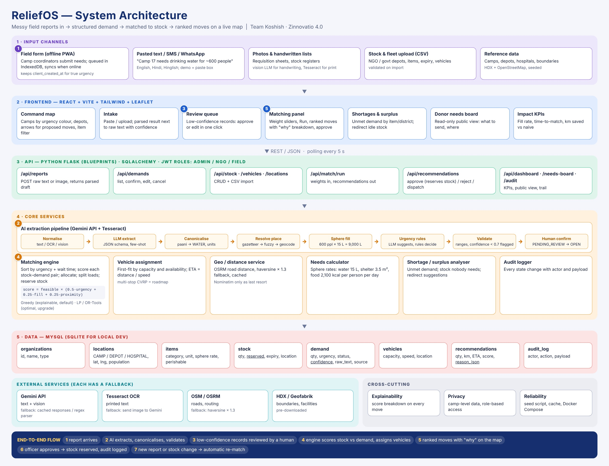
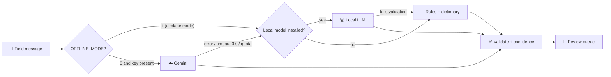

<div align="center">

# ⏱️ Hackathon Plan v2: Build 90% Before 30 Oct, Online + Offline

**Pre-build 17-29 Oct · Freeze 29 Oct · Showtime 30-31 Oct, Chandigarh University**

[⬅ Back to README](../README.md) · [Architecture](08_tech_stack_architecture.md) · [Offline design](11_offline_infrastructure.md) · 


</div>



> **What changed in v2:** offline is now a **must-build**, not a stretch. That adds new work to every person, so the split, schedule, gates, risks and demo script are all redone. New section: [what works without API keys](#-offline-what-works-without-api-keys).

---

## 🚦 Step zero: check the rules (do this today)

> ⚠️ **Many hackathons require code to be written on site, or limit pre-built code.** Your plan to arrive with ~90% built only works if the rules allow it. Do not assume.

**Email the organisers today** (keep the reply):
> *"Our team (Koshish, ReliefOS) was shortlisted. May we bring a pre-built prototype, and what are the rules on pre-written code? If not allowed, what may we prepare in advance (data, designs, libraries)? Also: will there be power sockets at every desk, and may we bring our own Wi-Fi router?"*

| If the answer is | Then |
|---|---|
| ✅ Pre-built prototype allowed | Follow this plan as written |
| ⚠️ Allowed with disclosure | Same plan. Declare it on the first slide: "prototype built before, new features built on site" |
| ❌ Must be written on site | Keep only: research, datasets, scenario data, designs, gold set, libraries, offline data packs (map data, gazetteer, dictionary) and `match.py` logic. Re-type the app on site using the [fallback split](#-fallback-if-pre-built-code-is-banned) |

---

## 🎯 What "90% built" means

| Area | Target by 29 Oct | Built before | Left for the event |
|---|---|---|---|
| 🗄️ Database and seed data (Punjab scenario) | 100% | ✅ | New judge-chosen scenario in 15 min |
| 🤖 AI extraction, **online** (Gemini: text, Hinglish, photo) | 95% | ✅ with cached fallbacks | Tune on judges' live messages |
| 📏 AI extraction, **offline** (rules parser + dictionary) | 90% | ✅ | Add words from judges' messages |
| 💻 Local LLM mode | Measured, then keep or drop | ✅ only if accuracy is acceptable | n/a |
| ✅ Review queue (human confirm) | 100% | ✅ | n/a |
| ⚖️ Matching engine (greedy + LP) | 100% | ✅ | n/a |
| 🗺️ Command map, matching panel, needs board | 90% | ✅ | Visual polish |
| 🗺️ **Offline basemap** (bundled GeoJSON; tiles optional) | 100% / 70% | ✅ | n/a |
| 📊 Impact numbers (simulated, naive vs ReliefOS) | 90% | ✅ | Re-run after tweaks |
| 📴 **Offline field form** (queue + auto-send, UUIDs) | 100% | ✅ | n/a |
| 📦 **"ReliefOS in a box"**: whole app on one laptop, own hotspot, no internet | 100% | ✅ one-command launcher | Venue-specific network fixes |
| 🔁 One-way sync (local node to a second instance) | 50% | Stretch | Stretch only |
| 🎤 Pitch deck, demo script, backup video | 80% | ✅ drafts | Final polish and rehearsal |

**The 10% on site** is: judge-driven scenarios, polish, bug fixes, the live demo, answering questions, and one stretch feature.

---

## 🌐 Website or app? Decision: a responsive website (PWA)

| Option | Verdict |
|---|---|
| 🟢 **Responsive website built in React** | **Choose this.** It is what the deck pitched. Judges open a link, nothing to install |
| 🟢 **PWA layer on top** (installable, offline queue) | Makes the same website behave like an app on a phone. Needed for the offline story |
| 🔴 Native mobile app (React Native / Flutter) | Do not build now. Doubles the front-end work. Say "native app" is on the roadmap |

Pitch wording: *"ReliefOS is a web platform for control rooms, with a mobile-friendly field form that keeps working with no signal, and a control-room mode that runs on one laptop with no internet."*

> ⚠️ **Gotcha to test early [B]:** browsers allow **service workers** (the part that lets an app open with no network) only on **HTTPS or localhost**. A phone that opens `http://192.168.x.x` on the laptop's hotspot is *not* secure, so the service worker will not register there. The **IndexedDB queue still works** over plain HTTP. See [offline options](#-the-https-on-lan-problem).

---

## 📴 Offline: what works without API keys

### ❓ Your question: "Will offline work completely without API keys being called?"

**Short answer: the core will, but only if we build the fallbacks. As currently written in `docs/08`, it will not.** The only thing that truly needs an API **key** is Gemini. But several other pieces need the **internet** even though they need no key. Each one fails silently or hangs in airplane mode unless we replace it.

| # | Piece | Needs internet or key? | Works offline today? | Offline alternative | Owner |
|---|---|---|---|---|---|
| 1 | **Gemini text extraction** | Internet + key | ❌ | **Rules parser** (always available) → optional **local LLM** → cached answers (scripted inputs only) | 3 |
| 2 | **Gemini photo / handwriting** | Internet + key | ❌ | Tesseract for **printed** lists only (install Hindi data). Handwriting is **online-only**: offline, the photo is saved in the queue and parsed when internet returns | 3 |
| 3 | Tesseract OCR | No | ✅ (install it and its language data before the event) | n/a | 3 |
| 4 | Flask, SQLite, matcher, review queue | No | ✅ | n/a | 2, 4 |
| 5 | **Public OSRM demo server** (road distance) | Internet | ❌ | **Haversine × 1.3** as the offline default. Optional local OSRM with a regional map extract | 4 |
| 6 | **Nominatim** (place search) | Internet | ❌ | **Gazetteer** of camps, depots and districts + rapidfuzz + manual pin on map | 3 |
| 7 | **OpenStreetMap map tiles** | Internet | ❌ | **Bundled GeoJSON basemap** (Punjab districts, rivers, your markers): tiny and reliable. Local tiles as an upgrade | 1, 4 |
| 8 | **CDN files** (fonts, Leaflet, React, icons) | Internet | ❌ unless bundled | Bundle everything with Vite; self-host fonts and icons. **The most common "worked on my laptop" failure** | 1 |
| 9 | pip / npm / Docker image downloads | Internet at install | ❌ at the venue | Pre-install, pre-pull images, keep wheels and `node_modules` on the USB | 4 |
| 10 | MySQL | No (local) | ✅ but heavy | **SQLite** file on the box via env switch | 2 |
| 11 | Service worker on a phone via the laptop's IP | n/a | ⚠️ needs HTTPS [B] | See [HTTPS on LAN](#-the-https-on-lan-problem) | 1, 4 |
| 12 | `reliefos.local` name (mDNS) | n/a | ⚠️ flaky on some Android phones [B] | Show **IP + QR code**; do not depend on the name | 4 |

### ✅ What this means in plain words (Hinglish bhi)

- **Without internet, ye sab chalega:** form, review queue, matching, map markers, KPIs, stock reservation. **No key is touched.**
- **Sirf AI ki quality girti hai.** Offline, extraction uses rules + dictionary (and maybe a small local model). Hinglish accuracy will be **lower**, so **every offline record goes to the review queue**. That is a feature to show, not hide.
- **Cached Gemini answers are not an offline AI.** They only replay the exact inputs we saved. If a judge types a fresh message in airplane mode, only the rules parser or local LLM can handle it. So the offline demo inputs must be tuned for the rules parser.

### 🔗 The fallback chain (build this once, early)



### 🧱 Rules that make it real

| Rule | Why |
|---|---|
| `OFFLINE_MODE=1` **disables** Gemini, public OSRM and Nominatim at start-up, not by waiting for timeouts | Three timeouts of 10 s each would freeze the demo |
| Online mode uses a **3 s timeout, then falls back** | A flaky venue network must not stall the demo |
| One interface: `ExtractionProvider.extract(...) -> DemandDraft`, with `provider` stored on every record | UI shows "parsed by: Gemini / Local / Rules" |
| All providers pass through the **same validator and review queue** | Wrong offline answers are caught the same way |
| **The form works with no AI at all** | AI helps when available and never blocks intake |
| API key lives only in the backend `.env`, never in React, never committed. Ship `.env.example` | Offline mode needs no key at all |
| `/api/health` reports `{mode, providers_available, db}` | One glance tells you what the box thinks it is |

### 🔒 The HTTPS-on-LAN problem

Phones joining the laptop's hotspot reach it over plain HTTP. Options, in order of effort **[B] verify on real phones**:

| Option | Effort | Result |
|---|---|---|
| **A. Plain HTTP + IndexedDB queue, no service worker, for the hotspot demo** | Low | Phone opens the form from the laptop, submits, queue works. Page itself cannot reopen with zero connection. **Enough for the demo** |
| **B. First load from a cloud link (Render etc.), then offline** | Low | Service worker installs over HTTPS; app shell opens with no network afterwards. Needs internet once, so say so honestly |
| **C. Local HTTPS** with a self-signed certificate (for example `mkcert`) and the certificate installed on the demo phones | Medium | Full PWA behaviour on the hotspot. Do only if A and B are solid |

**Decision:** build **A** first (Must), **B** as the real PWA story, **C** only as a Nice.

### 🧪 How we prove it is offline (the "network guard")

1. **Automated:** a pytest fixture makes any outbound socket connection raise an error. The full happy-path test must still pass.
   ```python
   # tests/conftest.py
   import socket, pytest

   @pytest.fixture
   def no_network(monkeypatch):
       def guard(*args, **kwargs):
           raise RuntimeError("Network call attempted in OFFLINE_MODE")
       monkeypatch.setattr(socket.socket, "connect", guard)
   ```
2. **Manual:** laptop in airplane mode, `OFFLINE_MODE=1`, open the browser dev tools Network tab and confirm **zero failed external requests** (this is how you catch hidden CDN files).
3. **Rehearsal:** fresh laptop, internet physically off, two inputs that were never cached.

---

## 👥 Work split by tech (4 people)

Split by **technology area only**. Deployment, the demo script, the pitch and the PPT are **not** assigned here: they are done together near the end and can be divided then. Offline work is **inside** each tech area, so nobody owns "offline" alone and nothing falls between two people.

| | Person | Tech area | Owns (online + offline) | Main tools |
|---|---|---|---|---|
| 🖥️ | **1. Frontend** | Everything the user sees | All React screens (map, intake, review queue, matching panel, shortages, needs board, KPIs), Leaflet map, API client, responsive layout. **Offline:** service worker, IndexedDB queue with client UUID + `client_created_at`, auto-send, "Queued: 3" banner, mode badge (Online / Offline), GeoJSON basemap layer, optional local tile layer, QR join page, **bundle every asset locally** | React, Vite, Tailwind, Leaflet, IndexedDB |
| ⚙️ | **2. Backend and database** | Server, data and API | Flask app, SQLAlchemy models, all REST endpoints, CSV import, seed loader, stock reservation, audit log, basic role login. **Offline:** `OFFLINE_MODE` config, **SQLite mode** via env switch, **idempotent endpoints** (same UUID twice = one record), op-log table, `/api/health`, serving the React build from Flask, optional one-way sync endpoint | Flask, SQLAlchemy, MySQL/SQLite, pytest |
| 🤖 | **3. AI and extraction** | Messy input to structured data | Gemini prompts and schema, canonicaliser, location resolver, Sphere needs calculator, urgency rules, validator and confidence, cached responses, gold set and accuracy evaluation. **Offline:** the **provider interface and fallback chain**, **rules parser**, **Hindi/English/Hinglish item and unit dictionary**, Tesseract for printed lists, **local LLM trial** (measure on gold set, keep or drop), accuracy **per mode** | Gemini API, Tesseract, Pydantic, rapidfuzz, optional Ollama |
| ⚖️ | **4. Matching, geo and offline node** | Decision logic and the "box" | Scoring, greedy matcher, LP optimiser, vehicle assignment, shortage and surplus analysis, simulation, KPI calculations, unit tests. **Offline:** haversine as default, optional local OSRM, **offline map data** (district GeoJSON, optional tiles), **`run_offline` one-command launcher**, hotspot setup, HTTPS option, IP + QR, **pre-installed packages and pre-pulled images on the USB**, the **network-guard test** and airplane-mode checklist | Python, SciPy/OR-Tools, OSRM, shell, pytest |

### ⚖️ Why this balance (rough effort, not a measurement)

| Person | Before | New offline work | How the load was balanced |
|---|---|---|---|
| 1 Frontend | Biggest | Medium (service worker, queue, banner, bundling) | Keeps the biggest area. Person 2 takes the **Needs board and Shortages API + CSV export** early; Person 4 supplies simulation data in a ready JSON for the KPI panel, so Person 1 only draws it |
| 2 Backend | Medium | Medium (SQLite switch, idempotency, op-log, health) | Finishes the API by 21 Oct, then supports Person 1 and the sync stretch |
| 3 AI | Heavy | **Heavy** (rules parser, dictionary, local LLM) | **Everyone writes ~35-40 gold-set messages** (a writing job, not code). Person 3 owns the format and the evaluation script only |
| 4 Matching + geo | Lightest | **Heavy** (offline node, map data, packaging, tests) | This is where the new load goes |

### 🔌 Contracts (agree on day 1, then work in parallel)

Each person codes against an agreed JSON shape, using fake data until the real part is ready.

| Boundary | Contract |
|---|---|
| **Frontend ↔ Backend** | Endpoint list in `docs/08` section 6. Backend publishes example responses first; Frontend starts with mock JSON. **New:** `POST /api/reports` accepts `{client_uuid, client_created_at, text/image, source}` and is **idempotent** on `client_uuid` |
| **AI ↔ Backend** | `extract(text_or_image) -> DemandDraft {items[], location_text, lat, lng, beneficiaries, urgency, confidence, raw_text, provider}`; Backend stores it as `PENDING_REVIEW` |
| **Matching ↔ Backend** | `match(demands[], stock[], vehicles[], weights) -> recommendations[] {demand_id, stock_id, vehicle_id, qty, km, eta_h, score, reason}` |
| **Matching ↔ Geo** | `distance(a, b) -> {km, eta_h, source}` where `source` is `osrm` or `haversine` (shown in the UI) |
| **Backend ↔ everyone** | `GET /api/health -> {mode: online/offline, providers: [...], db: sqlite/mysql}`. Frontend reads it for the mode badge |
| **Launcher ↔ everyone** | `OFFLINE_MODE=1 ./run_offline.sh` starts the whole app with no network calls. Anything that breaks it is a bug in its owner's area |

### 🤝 Who leans on whom

- **1 ↔ 2:** screens, endpoints and the idempotent report endpoint. Daily sync for the first week.
- **2 ↔ 3:** the report endpoint calls the provider chain. Agree `DemandDraft` first.
- **2 ↔ 4:** the match endpoint calls the matcher; the launcher serves the build that Person 1 produces.
- **1 ↔ 4:** map data and tiles, bundling check, HTTPS decision on real phones.
- Everyone reviews at least one other area's pull requests, and everyone can run the whole system **in airplane mode**.

---

## 🗓️ Pre-build schedule (17-29 Oct)

Person numbers refer to the [tech split](#-work-split-by-tech-4-people). Demo, pitch, deck and deployment are shared tasks.

| Dates | Milestone | Who | Definition of done |
|---|---|---|---|
| **17-18** | 🧱 **Foundations + offline skeleton.** Repo, branches, Docker Compose, schema, one-command seed. **From day one:** UUID ids, `OFFLINE_MODE` env switch, empty provider interface, `/api/health`. Decide: Flask, SQLite local / MySQL compose, greedy matcher, Punjab flood | 2 + 3 + all | `docker compose up` and `OFFLINE_MODE=1` both show an empty app with a health check |
| **18-19** | 🗃️ **Data.** Punjab scenario: 8-12 depots, 15-25 camps, vehicles, stock. **Gazetteer with Hindi/English names.** Sphere table. Find and licence-check a Punjab district GeoJSON. Everyone starts their share of the gold set | 2 + 3 + 4 | Seed loads; map shows markers on the bundled basemap |
| **19-21** | 🤖 **Extraction v1.** Gemini provider, canonicaliser, Sphere fill, resolver, validator **and the rules parser v1 with dictionary** | 3 | 10 messages parse end to end in **both** online and rules mode |
| **19-21** | ⚖️ **Matching v1.** Port `match.py`: scoring, greedy, reservation, shortage report. **Haversine as default distance** | 4 | Problem-statement example solved correctly in a unit test |
| **19-21** | ⚙️ **API + SQLite mode.** All endpoints, idempotent reports, SQLite switch, health | 2 | Same test suite passes on SQLite and MySQL |
| **19-22** | 🖥️ **UI skeleton.** Map on GeoJSON basemap, intake page, demand list; **all assets bundled, no CDN** | 1 | Paste text, see a record appear; Network tab shows no external requests |
| **21-22** | 📴 **Offline field form v1.** IndexedDB queue, UUID, auto-send, banner | 1 + 2 | Submit with the server off, start the server, the record appears **once** |
| **22-24** | 🔗 **Integrate (online).** Report → review → confirm → match → moves on map. Approve reserves stock | all | The "wow" flow works with no manual DB edits |
| **22-24** | 📦 **Offline node v1.** `run_offline.sh`, Flask serves the build, hotspot, IP + QR page, pre-installed packages | 4 + 2 | Whole demo flow in **airplane mode** on one laptop |
| **23-25** | 📊 **Evidence.** Gold-set evaluation **per mode** (Gemini / rules / local LLM), simulation, KPI panel, LP optimiser | 3 + 4 | Numbers on a slide, labelled "simulated"; offline accuracy shown honestly |
| **24-26** | 🛟 **Offline hardening.** Real phone joins the laptop hotspot and submits; HTTPS decision (A/B/C); local tiles if cheap; local LLM measured or dropped; network-guard test in the suite; seed reset button; error states | 1, 2, 3, 4 | Phone report appears on the laptop map with internet off |
| **26-27** | 🎬 **Demo and deck.** Script (with the offline moment), slides, backup video, judge Q&A | all (not split by tech) | Two full rehearsals timed under 3 min |
| **27** | 🔌 **Offline dress rehearsal.** Fresh laptop, internet **physically off**, two inputs never cached | all | Passes, or the failure list is fixed on 28 |
| **28** | 🧪 **Bug bash and freeze candidate.** Fresh-laptop install: clone, run, demo, online **and** offline | all | Someone who did not write the code runs both modes |
| **29** | 🧊 **Feature freeze.** Bug fixes only. Pack the kit. | all | Tag `v1-demo` |

> Buffer rule: if a milestone slips by a day, cut the stretch items (sync, local tiles, local LLM, HTTPS option C), never the end-to-end flow and never the offline Must items.

---

## ✅ Must-have vs nice-to-have

### 🟢 Must be perfect (the scoring path)
1. Paste a messy report (English and Hinglish), get structured demand with a confidence score.
2. Low-confidence record lands in a **review queue**; approve it with one click.
3. Run matching; map shows the move, quantity, distance, ETA and **why**.
4. **Before/after:** naive nearest-stock vs ReliefOS (urgency-aware, split loads).
5. A new critical report arrives and the plan **re-balances live**.
6. Shortage report: "500 medical kits short, nearest source is X".
7. **Offline moment:** laptop in airplane mode, phone on its hotspot submits a report, it appears on the map, the matcher proposes a move.
8. **Whole app starts with `OFFLINE_MODE=1` and makes zero outside calls.**
9. Backup recording of all of the above.

### 🟡 Nice (build if the must-haves are solid)
- Photo/handwritten list intake (online only; offline it is queued)
- Weight sliders that visibly change moves
- Donor needs board
- LP optimiser toggle
- Local map tiles and local OSRM
- Local LLM mode (only if measured accuracy is acceptable)
- Local HTTPS for the phones (option C)

### 🟣 Stretch
- One-way op-log sync from the local node to a second instance

### 🔴 Do not build
- Real WhatsApp or SMS integration · LoRa or satellite · multi-node merge · payments · full auth and multi-tenant roles · multi-disaster support · training any model · **live dependence on any service without a fallback.**

---

## 🧪 Quality gates (no gate, no freeze)

| Gate | Test |
|---|---|
| **Extraction (online)** | ≥ 85% field accuracy on the gold set. Report item, quantity, location and urgency separately |
| **Extraction (offline)** | Accuracy of the rules parser measured and **reported separately**. No target promised; every offline record must reach the review queue |
| **Matching** | Stock never goes negative; a critical demand beats a low one; reserved stock is not double-booked; the problem-statement example is solved correctly |
| **End-to-end** | 5 scripted demo inputs produce the expected moves 3 times in a row |
| **Offline (automated)** | Happy-path tests pass with the `no_network` fixture |
| **Offline (manual)** | Airplane mode, `OFFLINE_MODE=1`: demo runs, dev tools show **zero external requests**, 2 never-cached inputs handled |
| **Queue** | Submit offline, reconnect, the record appears **exactly once** (test with a double send) |
| **Phone on hotspot** | A real phone, not an emulator, submits to the laptop with no internet |
| **Fresh install** | A teammate clones and runs it in under 10 minutes, in both modes |

---

## 🛟 Risk and fallback table

| Risk | Fallback |
|---|---|
| Gemini API down, rate-limited or no key | Provider chain falls back to local LLM, then rules; cached answers for scripted inputs |
| **Judge types a fresh message in airplane mode** | Rules parser handles the common pattern; if not, it lands in the review queue as low confidence and the human fixes it: turn it into a feature demo |
| Local LLM too slow or too wrong in Hinglish | Drop the mode; keep rules + review. Do not mention it in the pitch |
| Routing service fails | Haversine × 1.3, cached distances |
| **Map blank in airplane mode** | Bundled GeoJSON basemap (always shipped); tiles are only an upgrade |
| **A CDN file sneaks in and breaks offline** | Network-tab check on every build; all assets bundled |
| **Phone cannot open the laptop page** | Check the phone stays on the hotspot (Android may jump to mobile data when a Wi-Fi has no internet [B]); use IP + QR, not `.local`; keep the video backup |
| Service worker will not install over HTTP | Use the IndexedDB queue without a service worker (option A); explain honestly |
| Venue Wi-Fi bad | Own hotspot or small router; everything runs locally; video backup |
| Laptop dies or power cut | Repo, data and packages on two laptops and a USB drive; power bank; video on phone |
| Matching gives a surprising result | "Why" breakdown explains it; sliders show sensitivity |
| Rules ban pre-built code | See below |

---

## 🧯 Fallback if pre-built code is banned

Keep before the event: research, datasets, **scenario data, gazetteer, offline dictionary, district GeoJSON**, gold set, prompts, designs and wireframes, the algorithm design and `prototype/match.py` as reference.
Write on site (priority order): 1) seed + map on bundled basemap, 2) extraction with rules parser first and Gemini second, 3) review queue, 4) matcher, 5) offline form + launcher, 6) KPIs.
Use the 36 hours as: 0-6 foundations (with `OFFLINE_MODE` from the start), 6-14 extraction, 14-22 matching, 22-28 UI, offline form and integration, 28-32 evidence and airplane-mode test, 32-36 pitch.
Writing the offline switch first costs minutes now and saves hours later.

---

## 🎬 3-minute demo script

| Time | Beat | On screen |
|---|---|---|
| 0:00 | **The problem.** "Stock sits in Ludhiana. Need is in Ferozepur. Nobody connects them." | Map with idle stock and red camps |
| 0:20 | **Messy report in.** Paste "Camp 17 needs drinking water for approximately 600 people" and a Hinglish one | Intake page |
| 0:40 | **AI structures it.** Water, 9,000 L/day, Critical, Camp 17, with confidence. The shaky one goes to review | Parsed result, review queue |
| 1:05 | **Matching runs.** Move appears: depot, quantity, ETA, **why** | Map and move card |
| 1:30 | **Before and after.** Naive vs ReliefOS: coverage and time | KPI panel (label "simulated") |
| 1:50 | **New critical report arrives**, plan re-balances live | Moves change |
| 2:10 | **📴 Offline moment.** Laptop to airplane mode. A teammate's phone, on the laptop's own hotspot, submits "pani 600 log camp 17". It appears on the map and the matcher proposes a move. *"No internet anywhere. This is a control room after a tower goes down."* | Airplane icon, phone, map, mode badge "Offline · Rules" |
| 2:40 | **Close.** Who pays: NGO SaaS, CSR dashboards, government pilots. "Right help. Right place. Right time." | Closing slide |

Rules: say "real-time" only for what you just showed. Say "offline" only for what runs in airplane mode. The offline message must be one you rehearsed against the rules parser.

---

## ❓ Judge Q&A cheat sheet

| Question | Answer |
|---|---|
| *"Hasn't IDRN or Sahana done this?"* | "Those are registries and request trackers. We add AI intake and an explainable, capacity-aware decision layer, and can sit on top of them." ([details](07_competitive_landscape.md)) |
| *"What if the LLM is wrong?"* | "Confidence scores, validation against Sphere ranges, human approval before dispatch. Literature shows request classification is noisy, so we designed for it." |
| *"How accurate is it?"* | "X% field accuracy on our 150-message test set" (use the real number, **per mode**) |
| *"Does it work with no internet?"* | "Yes for the core. The field form queues on the phone. The control room runs on one laptop and its own Wi-Fi: intake, review, matching and map. AI extraction falls back to rules and, optionally, a small local model. That is less accurate, so every record goes to human review. Gemini improves it when online." |
| *"Does the AI need an API key offline?"* | "No. Offline mode makes no outside calls. The key is only used for the cloud model when internet exists." |
| *"What does offline not do?"* | "Handwritten photo reading and live road routing need internet. Offline we queue the photo and use straight-line distance × 1.3. Multi-box sync is on the roadmap; we have a basic one-way version." |
| *"Where does data come from?"* | "NGO and warehouse uploads, field forms, messages. Pilot with one district or NGO network." |
| *"How did you build so much?"* | "We prepared before the event, as the format encourages. Here is what we built on site." (only if the rules allowed it) |
| *"Who pays?"* | "NGO SaaS first; CSR teams want delivery proof; government contracts later." |
| *"Impact numbers?"* | "Simulated on a Punjab-style scenario. Method is in the repo." |

---

## 🧰 Packing and on-the-day checklist

- [ ] Laptops × 2 with repo, data and cached responses; chargers; extension cord; **power bank**
- [ ] **Small Wi-Fi router** (if allowed) and phone hotspot with data; HDMI and USB-C adapters
- [ ] **Offline pack on USB:** repo, pip wheels, `node_modules` or built frontend, pre-pulled Docker images (saved), Tesseract + Hindi data, district GeoJSON, optional tiles and local model
- [ ] **Two test phones** already set up for the hotspot flow; printed **QR sheet** with the laptop IP
- [ ] Repo zip and demo video on a USB drive and on phones
- [ ] Printed one-page architecture (`images/architecture.jpg`) and QR code to the repo
- [ ] Demo inputs saved in a text file: **two online, two offline-tuned**
- [ ] `.env` with the Gemini key on the demo laptop only; never in the repo
- [ ] Sleep shifts agreed: two awake, two resting, rotate every 4 hours
- [ ] Pitch rehearsed 3 times, timed; one rehearsal fully in airplane mode

---

## 📋 Verify before relying on it

- [ ] Service worker behaviour over the hotspot on your actual phones **[B]**
- [ ] Whether Android phones drop a hotspot with no internet and switch to mobile data **[B]**
- [ ] Map data and licence for the Punjab GeoJSON; do **not** bulk-download tiles from the public OpenStreetMap tile server (its usage policy restricts this); use a regional extract or a tile provider that allows it **[B]**
- [ ] Local model size, speed and licence; run it on the gold set or drop it
- [ ] Current Gemini model names, limits and pricing
