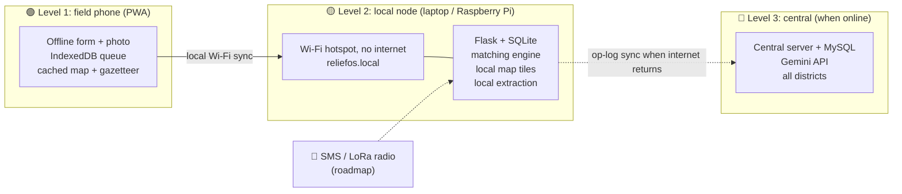

# 📴 Offline Infrastructure: ReliefOS in a Network-Free Zone

**Field phones that keep working · a "ReliefOS in a box" local server · sync when the network returns**

[⬅ Back to README](../README.md) · [Architecture](08_tech_stack_architecture.md) · [Hackathon plan](10_hackathon_plan.md)

> **Why this matters.** Disasters knock out towers and power. Your own deck lists *"Limited Connectivity"* as one of four risks. This doc turns that bullet into a real design, with an honest line between what we build now and what is roadmap.
>
> Tool descriptions below are from background knowledge **[B]**: confirm versions and limits before you rely on them.

---

## 🧭 The idea: three levels of "offline"

| Level | Situation | What works | Build now? |
|---|---|---|---|
| 🟢 **1. Offline phone/browser** | One field worker, no signal | Fill the form, take photos, see cached map, queue everything | ✅ Yes (PWA) |
| 🟡 **2. Local network node** ("ReliefOS in a box") | A control room or camp office with a laptop and a Wi-Fi hotspot, **no internet** | Full app for everyone on that Wi-Fi: intake, matching, map, review | ✅ Yes (one laptop) |
| 🔴 **3. Sync and long range** | Internet returns, or only SMS/radio exists | Merge local data with the central server; accept reports by SMS or radio | ⬜ Roadmap (basic sync = stretch) |

---

## 🟢 Level 1: the offline field device

**Goal:** a camp coordinator can report needs with zero signal and nothing is lost.

| Piece | How | Notes |
|---|---|---|
| **App shell works offline** | PWA service worker caches the React app | After the first load, it opens with no network |
| **Local queue** | Reports and photos saved in IndexedDB with a client-generated UUID and `client_created_at` | The true time of the report is kept for urgency |
| **Auto-send** | Background sync, or retry when the app sees the server again | Idempotent: same UUID twice never creates two reports |
| **Offline map** | Pre-downloaded map tiles for the operating area (MBTiles/PMTiles) cached for Leaflet **[B]** | Download the Punjab region before the event |
| **Offline place names** | Gazetteer of camps, depots and districts bundled in the app | Location resolution works without geocoding APIs |
| **Offline help text** | Item names in English/Hindi, quantity units, urgency picker | A structured form needs no AI at all |
| **Basic on-device parsing** | Keyword and number rules ("pani", "water", "600 log") fill the form fields | Always editable; marked low confidence |

Design rule: **the form should work with no AI.** AI makes intake easier when available, and never blocks it.

---

## 🟡 Level 2: "ReliefOS in a box" (local node)

**Goal:** the whole system runs on one laptop (or Raspberry Pi **[B]**), with phones joining its own Wi-Fi. No internet anywhere.

### What runs on the box

| Component | Offline choice | Fallback / limit |
|---|---|---|
| **Backend** | Flask + SQLAlchemy | Same code as cloud |
| **Database** | **SQLite** file on the box | MySQL is for the central server; same models |
| **Frontend** | React build served by Flask | Same app |
| **Maps** | Local tile server for the area (MBTiles via tileserver-gl, or PMTiles) **[B]** | Plain base map with only markers if tiles are missing |
| **Routing** | OSRM with a **regional** OSM extract prepared in advance **[B]** | Haversine × 1.3 (works with zero setup) |
| **Extraction** | See below | Rules + human review always available |
| **Network** | Laptop as Wi-Fi hotspot, or a small travel router, local name `reliefos.local` (mDNS) | Show a QR code with the IP for join |

### Extraction with no internet: three modes

| Mode | When | Quality |
|---|---|---|
| ☁️ **Gemini API** | Internet available | Best, handles Hinglish and photos |
| 💻 **Local LLM** (e.g. a small open model run with Ollama) **[B]** | No internet, laptop has enough RAM/GPU | Good for simple English; Hindi/Hinglish weaker. **Test it on your gold set** before promising anything |
| 📏 **Rules + human review** | Always possible | Lowest, but never fails; all records go to the review queue |

The app picks the best available mode automatically and shows which one produced each record.

### Power and hardware kit (concept)
Laptop or Raspberry Pi, power bank or solar charger, small Wi-Fi router, USB SSD with the repo, map tiles and data, printed QR sheet. Prices not checked: do not quote any.

---

## 🔴 Level 3: sync and long-range input (roadmap, with a simple stretch version)

### Why it is hard: conflicts
Two boxes offline can both change stock or both claim the same blankets. So:

| Rule | Why |
|---|---|
| **IDs created on the device** (UUIDs) | No clash when merging |
| **Append-only operation log** (`report_created`, `stock_delta`, `move_approved`) | Merge by replaying operations, not by overwriting rows |
| **Stock as deltas**, not absolute numbers | Two boxes can both subtract stock safely, and the central total stays right |
| **Reservations arbitrated centrally** | If two nodes promised the same stock, the central server resolves it and flags the loser for re-match |
| **Idempotent apply** | Replaying the same operation twice is harmless |
| **Keep original timestamps** | Urgency and waiting time stay honest |

**Options:** build a small op-log sync endpoint on Flask (recommended, you control it), or adopt a database with built-in replication such as CouchDB/PouchDB **[B]** (less code, but a different data model from your plan). **Hackathon stretch:** one-way sync from the local node to the cloud server with the op-log.

### Long-range, no-internet input (pitch as roadmap)
- **SMS gateway** with a short structured format (`NEED WATER 600 CAMP17`) plus free text. A phone with signal but no data can still report.
- **LoRa/mesh radio** (for example Meshtastic) **[B]** to carry short messages from remote camps to the box.
- **Satellite messenger** for the most remote areas.
Say these are future channels. Do not claim them as built.

---

## 🔐 Security for offline devices

- Encrypt the local database or at least the device disk **[B]**; PIN on the app.
- Per-device tokens, so a lost phone can be revoked when it syncs.
- Store camp-level data, not victim identities.
- Log every operation (audit log works offline too).

---

## 🛠️ Who builds what (by tech)

| Person | Offline tasks |
|---|---|
| 🖥️ **1. Frontend** | Service worker, IndexedDB queue, offline banner ("Queued: 3"), cached tiles in Leaflet, QR join page |
| ⚙️ **2. Backend/DB** | SQLite mode via env switch, idempotent endpoints (UUIDs), op-log table, optional sync endpoint, serving the build and tiles |
| 🤖 **3. AI/extraction** | Mode switch (API / local LLM / rules), offline rule parser, bundled Hindi/English item dictionary, accuracy of each mode on the gold set |
| ⚖️ **4. Matching/geo** | Haversine fallback as default offline, optional local OSRM for the demo region, offline map data preparation |

---

## ✅ Hackathon scope: what to build before 29 Oct

| Priority | Item | Done when |
|---|---|---|
| 🔴 Must | **Whole app on one laptop, Wi-Fi off:** SQLite, local build, haversine, cached extraction responses | Demo runs end to end in airplane mode |
| 🔴 Must | **PWA offline form** with queue and auto-send | Submit offline, reconnect, record appears once |
| 🟠 Should | **Local hotspot demo:** a phone joins the laptop's own Wi-Fi and submits a report | Report appears on the laptop's map |
| 🟠 Should | **Offline rule parser** fallback | "pani 600 log camp 17" yields a draft |
| 🟡 Nice | **Local map tiles** for the demo region | Map renders with the internet off |
| 🟡 Nice | **Local LLM mode** | Measured accuracy on the gold set reported honestly |
| 🟢 Stretch | **One-way op-log sync** to a second instance | Two instances show the same demands after sync |
| ⬜ Roadmap | SMS gateway, LoRa mesh, satellite, multi-node merge | Mentioned on the roadmap slide only |

### 🎬 The offline demo moment (30 seconds, very memorable)
1. Switch the laptop's Wi-Fi off. Show the airplane-mode icon.
2. A teammate's phone joins the laptop's own hotspot and submits "Camp 17 needs water for 600 people".
3. The record appears on the laptop's map; the matcher proposes a move.
4. Say: *"No internet anywhere. This is what a control room could run after a tower goes down."*

---

## ⚠️ Honest limits (say these before a judge asks)

- A local LLM may misread Hindi/Hinglish: that is why every record has a confidence score and review.
- Offline routing needs prepared map data for the region; without it we fall back to straight-line distance × 1.3.
- Multi-box sync is hard and is future work beyond a basic one-way version.
- A power cut ends everything on the box: plan batteries.

---

## 📋 Checklist to verify

- [ ] Test the PWA queue on a real phone with airplane mode
- [ ] Confirm the hotspot demo works on the venue's phones and your laptop's OS
- [ ] Measure the local LLM on the gold set, or drop that mode from the pitch
- [ ] Check the size of map tiles for the demo region and test loading them offline
- [ ] Confirm versions and licences of tileserver, OSRM, Ollama and any model you use
