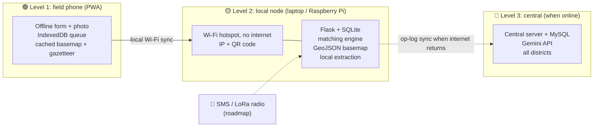

# 📴 Offline Infrastructure: ReliefOS in a Network-Free Zone

**Field phones that keep working · a "ReliefOS in a box" local server · sync when the network returns**

[⬅ Back to README](../README.md) · [Architecture](08_tech_stack_architecture.md) · [Hackathon plan](10_hackathon_plan.md)

-2ea44f)

> **Why this matters.** Disasters knock out towers and power. Your own deck lists *"Limited Connectivity"* as one of four risks. This doc turns that bullet into a real design, with an honest line between what we build now and what is roadmap.
>
> **What changed in v2:** offline is a **must-build**. The basemap is a bundled GeoJSON (tiles are optional), the hotspot demo and rules parser are Must, the HTTPS caveat for phones is added, and the work split matches [docs/10](10_hackathon_plan.md). Naming: **Level 1 = Mode C (phone)** and **Level 2 = Mode B (box)** in [docs/08](08_tech_stack_architecture.md).
>
> Tool descriptions below are from background knowledge **[B]**: confirm versions and limits before you rely on them.

---

## 🧭 The idea: three levels of "offline"

| Level | Situation | What works | Build now? |
|---|---|---|---|
| 🟢 **1. Offline phone/browser** (Mode C) | One field worker, no signal | Fill the form, take photos, queue everything, see the cached basemap | ✅ **Must** (queue and form); PWA app-shell caching depends on HTTPS, see below |
| 🟡 **2. Local network node** ("ReliefOS in a box", Mode B) | A control room or camp office with a laptop and a Wi-Fi hotspot, **no internet** | Full app for everyone on that Wi-Fi: intake, review, matching, map | ✅ **Must** (one laptop, airplane mode, one phone on its hotspot) |
| 🔴 **3. Sync and long range** | Internet returns, or only SMS/radio exists | Merge local data with the central server; accept reports by SMS or radio | ⬜ Roadmap (basic one-way sync = stretch) |

---

## 🔌 The one switch: `OFFLINE_MODE`

Everything below depends on one environment variable, set when the box starts: `OFFLINE_MODE=1 ./scripts/run_offline.sh`.

| What it does | Why |
|---|---|
| Removes **Gemini, public OSRM and Nominatim** at start-up | Nothing waits for a network timeout; a demo cannot freeze |
| Uses **SQLite** and the bundled data | Zero install, one file |
| Serves the React build and API from one Flask port | One address to join |
| Reports `{mode, providers, db}` at `GET /api/health` | The UI shows an "Offline · Rules" badge |

Online, Gemini gets a **3 s timeout** and then the chain falls back to the next provider. **No API key is needed offline**; the key is used only for the cloud model when internet exists.

---

## 🟢 Level 1: the offline field device

**Goal:** a camp coordinator can report needs with zero signal and nothing is lost.

| Piece | How | Notes |
|---|---|---|
| **Local queue** | Reports and photos saved in IndexedDB with a client-generated UUID and `client_created_at` | Works over plain HTTP too. The true time of the report is kept for urgency |
| **Auto-send** | Retry when the app sees the server again (background sync where supported **[B]**) | **Idempotent:** the same UUID twice never creates two reports |
| **App shell works offline** | PWA service worker caches the React app | ⚠️ Service workers need **HTTPS or localhost [B]**. On a phone using `http://192.168.x.x` it will not install. See the options below |
| **Offline basemap** | **Bundled GeoJSON** (Punjab districts, rivers) drawn by Leaflet; local tiles (MBTiles/PMTiles) are an optional upgrade **[B]** | A map is never blank in airplane mode |
| **Offline place names** | Gazetteer of camps, depots and districts (Hindi and English aliases) bundled in the app | Location resolution works without geocoding APIs |
| **Offline help text** | Item names in English/Hindi, quantity units, urgency picker | A structured form needs no AI at all |
| **Handwritten photos** | Saved in the queue with status `AWAITING_ONLINE` | Parsed when internet returns; offline reading of handwriting is not promised |
| **On-device parsing** *(Nice)* | Keyword and number rules fill the form fields | Always editable. The **server-side** rules parser on the box is the Must, see Level 2 |

Design rule: **the form should work with no AI.** AI makes intake easier when available, and never blocks it.

### 🔒 The HTTPS-on-LAN problem **[B: test on real phones]**

| Option | Effort | Result |
|---|---|---|
| **A. Plain HTTP + IndexedDB queue, no service worker** | Low | Phone opens the form from the laptop, submits, the queue works. The page itself cannot reopen with zero connection. **Enough for the hotspot demo** |
| **B. First load from a cloud link, then offline** | Low | Service worker installs over HTTPS; the app shell opens with no network afterwards. Needs internet once, so say so honestly |
| **C. Local HTTPS** with a self-signed certificate (for example `mkcert`) installed on the demo phones | Medium | Full PWA behaviour on the hotspot. Only if A and B are solid |

**Decision:** build **A** first (Must), **B** as the real PWA story, **C** as a Nice.

---

## 🟡 Level 2: "ReliefOS in a box" (local node)

**Goal:** the whole system runs on one laptop (or Raspberry Pi **[B]**), with phones joining its own Wi-Fi. No internet anywhere.

### What runs on the box

| Component | Offline choice | Fallback / limit |
|---|---|---|
| **Backend** | Flask + SQLAlchemy | Same code as cloud |
| **Database** | **SQLite** file on the box | MySQL is for the central server; same models |
| **Frontend** | React build served by Flask, **every asset bundled** (fonts, icons, Leaflet; no CDN) | A single CDN link breaks offline; check the Network tab |
| **Basemap** | **Bundled GeoJSON** of the demo region | Local tile server (MBTiles via tileserver-gl, or PMTiles) **[B]** as an upgrade; markers on a plain background if everything is missing |
| **Routing** | **Haversine × 1.3**, labelled as straight-line in the UI | OSRM with a **regional** OSM extract prepared in advance **[B]** if time allows |
| **Extraction** | See below | Rules + human review always available |
| **Network** | Laptop as Wi-Fi hotspot, or a small travel router. Show **IP + QR code** for join | `reliefos.local` (mDNS) is unreliable on some Android phones **[B]**, so never depend on it |

### What `run_offline.sh` does
1. Sets `OFFLINE_MODE=1` and `DATABASE_URL=sqlite:///reliefos.db`.
2. Checks that the dictionary, gazetteer and GeoJSON basemap are present (and reports whether a local model is installed).
3. Seeds the Punjab scenario if the DB is empty.
4. Starts Flask, serving the React app and API on one port.
5. Prints the laptop's IP and a QR code for phones.

### Extraction with no internet: the provider chain

| Mode | When | Quality | Confidence cap |
|---|---|---|---|
| ☁️ **Gemini API** | Internet available and key present | Best, handles Hinglish and photos | None |
| 💻 **Local LLM** (e.g. a small open model run with Ollama) **[B]** | No internet, model installed in advance, laptop has enough RAM/GPU | Good for simple English; Hindi/Hinglish weaker. **Test it on your gold set** before promising anything | Set from measured accuracy |
| 📏 **Rules + dictionary** | Always possible | Lowest, but never fails | **0.65**, below the 0.7 review threshold, so **every rules record goes to the review queue** |

The chain is Gemini → Local LLM → Rules. The app picks the best available provider automatically and **shows which one produced each record** (`provider` is stored on every demand).

> **Cached Gemini answers are not an offline AI.** They only replay saved demo inputs. A fresh message typed in airplane mode is handled by the rules parser or the local LLM, so rehearse the offline demo message against the rules parser.

### Power and hardware kit (concept)
Laptop or Raspberry Pi, power bank or solar charger, small Wi-Fi router, USB SSD with the repo, packages, basemap data and models, printed QR sheet. Prices not checked: do not quote any.

---

## 🔴 Level 3: sync and long-range input (roadmap, with a simple stretch version)

### Why it is hard: conflicts
Two boxes offline can both change stock or both claim the same blankets. So:

| Rule | Why |
|---|---|
| **IDs created on the device** (UUIDs) | No clash when merging |
| **Append-only operation log** (`report_created`, `stock_delta`, `move_approved`) | Merge by replaying operations, not by overwriting rows |
| **Stock as deltas**, not absolute numbers | Two boxes can both subtract stock safely, and the central total stays right |
| **Reservations arbitrated centrally** | If two nodes promised the same stock, the central server resolves it and flags the loser for re-match |
| **Idempotent apply** | Replaying the same operation twice is harmless |
| **Keep original timestamps** | Urgency and waiting time stay honest |

**Options:** build a small op-log sync endpoint on Flask (recommended, you control it), or adopt a database with built-in replication such as CouchDB/PouchDB **[B]** (less code, but a different data model from your plan). **Hackathon stretch:** one-way sync from the local node to a second instance with the op-log (`GET/POST /api/sync/ops`, `op_log` table).

### Long-range, no-internet input (pitch as roadmap)
- **SMS gateway** with a short structured format (`NEED WATER 600 CAMP17`) plus free text. A phone with signal but no data can still report.
- **LoRa/mesh radio** (for example Meshtastic) **[B]** to carry short messages from remote camps to the box.
- **Satellite messenger** for the most remote areas.
Say these are future channels. Do not claim them as built.

---

## 🔐 Security for offline devices

- Encrypt the local database or at least the device disk **[B]**; PIN on the app.
- Per-device tokens, so a lost phone can be revoked when it syncs.
- Store camp-level data, not victim identities.
- Log every operation (audit log works offline too).
- API key only in the backend `.env` on the demo laptop; never in React, never committed.

---

## 🛠️ Who builds what (by tech)

Same owners as [docs/10](10_hackathon_plan.md). Offline work sits **inside** each area, so nothing falls between two people.

| Person | Offline tasks |
|---|---|
| 🖥️ **1. Frontend** | Service worker (where HTTPS allows), IndexedDB queue with UUID + `client_created_at`, auto-send, "Queued: 3" banner, Online/Offline **mode badge** from `/api/health`, GeoJSON basemap layer, optional tile layer, QR join page, **bundle every asset locally** |
| ⚙️ **2. Backend/DB** | `OFFLINE_MODE` config, SQLite mode via env switch, **idempotent** `POST /api/reports`, `/api/health`, op-log table, optional sync endpoint, serving the React build, seed reset |
| 🤖 **3. AI/extraction** | Provider interface and fallback chain, **rules parser**, Hindi/English/Hinglish item and unit dictionary, Tesseract for printed lists, **local LLM trial** (keep or drop by 26 Oct), accuracy of each mode on the gold set |
| ⚖️ **4. Matching, geo and offline node** | Haversine default and `distance()` contract, optional local OSRM, **offline map data** (district GeoJSON, optional tiles), **`run_offline.sh`**, hotspot setup, IP + QR, HTTPS option, **offline pack on USB**, the **`no_network` test** and airplane-mode checklist |

---

## ✅ Hackathon scope: what to build before 29 Oct

| Priority | Item | Done when |
|---|---|---|
| 🔴 Must | **Whole app on one laptop, airplane mode:** `OFFLINE_MODE=1`, SQLite, bundled assets, haversine, GeoJSON basemap | Demo runs end to end with zero outside calls |
| 🔴 Must | **Offline field form** with IndexedDB queue and auto-send | Submit offline, reconnect, the record appears **once** |
| 🔴 Must | **Local hotspot demo:** a real phone joins the laptop's own Wi-Fi and submits a report | Report appears on the laptop's map |
| 🔴 Must | **Offline rules parser** and dictionary | "pani 600 log camp 17" yields a draft in the review queue |
| 🔴 Must | **Network guard:** `no_network` test passes; Network tab shows zero external requests | Both checks green |
| 🟡 Nice | **Local map tiles** for the demo region | Map renders tiles with the internet off |
| 🟡 Nice | **Local OSRM** for the demo region | Road distance with the internet off |
| 🟡 Nice | **Local LLM mode** | Measured accuracy on the gold set reported honestly; otherwise dropped |
| 🟡 Nice | **Local HTTPS** for the phones (option C) | Phone installs the PWA from the laptop |
| 🟢 Stretch | **One-way op-log sync** to a second instance | Two instances show the same demands after sync |
| ⬜ Roadmap | SMS gateway, LoRa mesh, satellite, multi-node merge | Mentioned on the roadmap slide only |

### 🎬 The offline demo moment (30 seconds, very memorable)
1. Switch the laptop's Wi-Fi off. Show the airplane-mode icon and the **"Offline · Rules"** badge.
2. A teammate's phone, already on the laptop's own hotspot, submits **"pani 600 log camp 17"** (a message you rehearsed against the rules parser).
3. The record appears in the **review queue**. Click **Approve** (rules records always need review).
4. The record shows on the laptop's map and the matcher proposes a move. The UI shows the distance as straight-line.
5. Say: *"No internet anywhere. This is what a control room could run after a tower goes down."*

---

## ⚠️ Honest limits (say these before a judge asks)

- A local LLM may misread Hindi/Hinglish; the rules parser is a dictionary tool. That is why every offline record has a confidence score and goes to review.
- Handwritten photo reading needs internet. Offline, photos are queued.
- Offline routing needs prepared map data for the region; without it we use straight-line distance × 1.3 and say so.
- A page opened over plain HTTP on the hotspot cannot reopen with zero connection (no service worker), though the queue works.
- Multi-box sync is hard and is future work beyond a basic one-way version.
- A power cut ends everything on the box: plan batteries.

---

## 📋 Checklist to verify

- [ ] Test the queue and the form on a **real phone** with airplane mode and on the laptop's hotspot
- [ ] Check whether Android drops a hotspot with no internet and switches to mobile data **[B]**; tell demo phones to stay connected
- [ ] Confirm the hotspot demo works on the venue's phones and your laptop's OS
- [ ] Confirm the Punjab GeoJSON source and licence; do **not** bulk-download tiles from the public OpenStreetMap tile server (its usage policy restricts this); use a regional extract or an allowed provider **[B]**
- [ ] Measure the local LLM on the gold set, or drop that mode from the pitch
- [ ] Check the size of any map tiles and test loading them offline
- [ ] Confirm versions and licences of tileserver, OSRM, Ollama and any model you use
- [ ] Run one rehearsal on a fresh laptop with the internet physically off, using two inputs that were never cached
